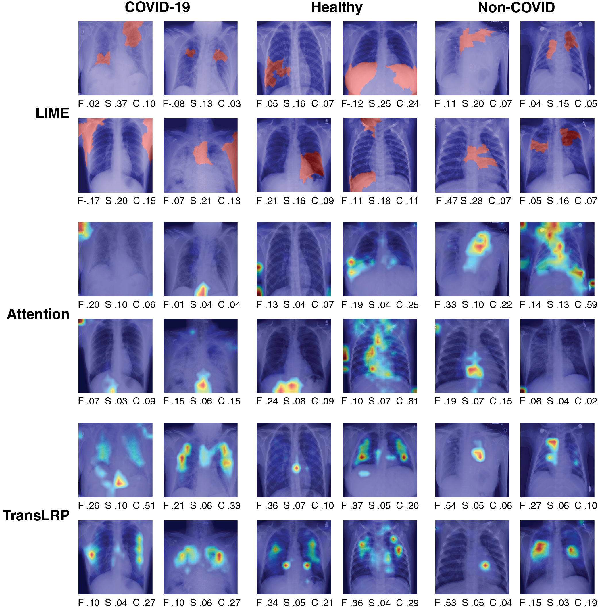

# 6. Supplementary explanations

See Fig. 3.

*Fig. 3. Exemplary explanations of ViT trained on the X-ray classification task. There are four images per class label (doubled columns) and each one is explained using three interpretation methods (doubled rows). For each explanation, we report their corresponding performance metrics measured with faithfulness (F), sensitivity (S), and complexity (C).*
