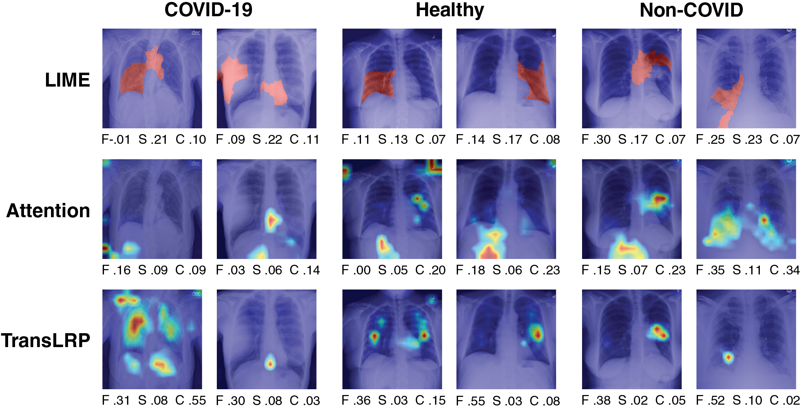

# 1. 引言

视觉 Transformer (ViT) (Dosovitskiy et al. 2021) 是一种使用自注意力机制 (Vaswani et al. 2017) 来处理图像序列块，而非依赖卷积操作的新型深度学习模型。ViTs 在图像分类任务上取得了令人瞩目的成果 (Chen et al. 2021; Dosovitskiy et al. 2021)，包括医学影像 (Tulder et al. 2021; Mondal et al. 2022)。然而，随着深度神经网络在医疗等关键领域中越来越广泛地部署，了解它们依赖哪些特征变得有价值 (Hryniewska et al. 2021)。可解释的人工智能 (XAI) 方法旨在通过生成人类可解释的模型行为表示来提供这种理解 (Lapuschkin et al. 2015; Ribeiro et al. 2016; Holzinger et al. 2022)。

几种可解释性方法已被提出或适应于视觉 Transformer (Abnar和Zuidema 2020; Chefer等人 2021b)，然而，这些方法的质量评估仍缺乏严格的和标准化的评估。为解决这一问题，我们提出利用两个关键标准，即忠实性 (Bhatt等人 2020) 和敏感性 (Yeh等人 2019; Bhatt等人 2020)，来评估这些解释的质量。此外，关于如何最好地可视化由视觉 Transformer 产生的注意力图，目前尚无明确共识，这些注意力图可能会变得模糊甚至误导人 (Bibal等人 2022)。

本论文首先介绍了评估忠实性、敏感性和复杂度的概念，特别是针对视觉 Transformer 的这些属性。ViT解释。然后，我们采用三种解释方法进行实验：模型无关的、基于自注意力的和基于梯度的，应用于一个视觉 Transformer 模型上。ViT在一个胸部X射线分类任务上训练（如图1所示）。具体而言，所得结果表明，基于梯度的方法在两个指标上均优于基线，提供了更准确且一致的解释。ViT决策。我们的目标是促进使用全面的指标来建立一个统一的基准测试协议。ViT解释，这对于医学影像领域至关重要。

*图 1. 示例解释了在 X 射线分类任务上训练的 ViT。每列有两个类别标签的图像，每张图像都使用三种解释方法进行解释。对于每种解释，我们报告其对应的性能指标，这些指标使用忠实性（F）、敏感性（S）和复杂度（C）进行测量。对于敏感性和复杂度，较低的分数更好，对于忠实性较高的分数更好。如图 6 所示，还有更多这样的示例。*
