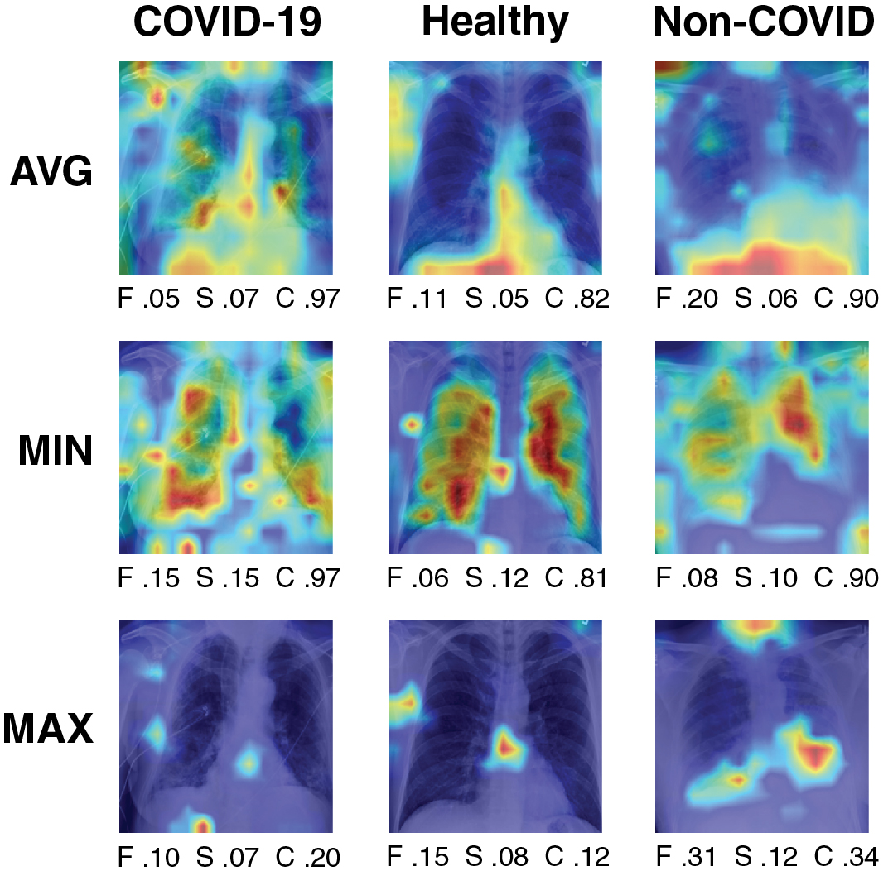

# 4. 医学影像实验

我们现在批判性地评估针对医学影像任务的 ViT 解释，特别是胸部 X 光片分类。

### 实验设置

我们使用**COVID-QU-Ex数据集**（Tahir et al. 2021），该数据集包含$33{,}920$ CXR包含的图像包括$11{,}956$COVID-19感染的图像$10{,}701$健康胸部 X 光片，和$11{,}263$非COVID感染，包括病毒性或细菌性肺炎。数据集作者推荐的$65/15/20$分别用于训练集、验证集和测试集，我们对一个**基础大小的**模型进行微调。ViT视觉 Transformer(Dosovitskiy et al. 2021)在ImageNet数据集(Deng et al. 2009)上进行了预训练。该模型在测试集上的准确率达到了$0.954$模型在所有三个类别上的准确率均值进一步描述于8节。对于计算解释评价指标，$300$从测试集随机采样图像，$100$每一类的图像。

|解释|忠实性$\uparrow$ |敏感性$\downarrow$ |复杂度$\downarrow$ |
|:---|:--:|:--:|:--:|
|LIME|$0.07_{\pm 0.13}$|$0.21_{\pm 0.06}$|$0.09_{\pm 0.04}$|
|自注意力|$0.10_{\pm 0.08}$|$0.07_{\pm 0.03}$|$0.16_{\pm 0.12}$|
|TransLRP|$0.16_{\pm 0.18}$|$0.06_{\pm 0.03}$|$0.21_{\pm 0.16}$|

评价结果中，较低的敏感性得分和较高的忠实性得分表示更好的解释。我们报告了基于$300$张图像计算出的$\pm$个指标值的平均值及其标准差。TransLRP优于LIME和注意力可视化，但提供了更复杂的解释。

### 结果

1 提出了一个基准，比较了在三个维度上感兴趣的解释方法。我们观察到TransLRP在基于两个主要评估标准的性能上，LRP（局部重要性解释）超越了其他基于技术。这两个标准分别是可信度和稍弱的敏感度。这表明，LRP 提供的特征 attribution 与模型预测结果高度相关，如其较高的可信度评分所示。此外，通过较低的敏感度指标值，可以证明其估计值在输入数据的小变化下保持了最大的一致性。

基于定量结果，TransLRP似乎是一个强有力的候选者，能够解释ViT在COVID-QU-Ex任务上的预测，因此可以推荐人类解释，放射学专家。对解释可视化进行定性评估表明，TransLRP在影像伪影方面通常具有鲁棒性，尽管存在导致预测的虚假相关实例（参见图1，第1列）。LIME的解释在图像之间更加一致，但其依赖于超像素可能会导致当焦点不完全在肺部时产生不准确性（参见图1，第2列和第6列）。与TransLRP和LIME相比，注意力可视化似乎生成了更加不准确的解释。更多示例见6。

### 可解释性中的质量与复杂度权衡

除了主要关注解释质量的指标外，我们还考虑了生成的解释的复杂度，这对于向人类呈现可视化时变得至关重要（参见关于信息过载的讨论（Poursabzi-Sangdeh et al. 2021））。1报告称，注意力解释的复杂度略低于TransLRP。然而，与注意力头的其他聚合方法相比，无论是哪种情况，其复杂度都相当低（参见3）。对于本次研究的目的，LIME的归因是二进制的，因此作为复杂性指标的一个相对简单基线。请注意，复杂性指标的值显著依赖于截断阈值，因此将偏向二进制特征归因，这应在未来的工作中加以解决。

### 不同类别的解释质量是否一致？

我们的研究揭示了在COVID-19、非COVID和健康CXR案例中生成的归因质量的差异性，如图2所示。可能地，基于医学影像的COVID肺炎的重叠症状特征可能限制了生成的归因效果（Hryniewska et al. 2021）。相反地，非COVID肺炎和健康CXR案例中的更多明确指示可能有助于产生更准确的解释。这样的分析尤其重要，以评估在不平衡类别分布下的偏见。在每种情况下，都需要进一步的解释基准测试来验证这一挑战。

|类别|忠实性$\uparrow$ |敏感性$\downarrow$ |复杂度$\downarrow$ |
|:---|:--:|:--:|:--:|
| COVID-19 |$0.07_{\pm0.13}$|$0.07_{\pm0.03}$|$0.34_{\pm0.19}$|
|健康|$0.22_{\pm0.17}$|$0.05_{\pm0.02}$|$0.16_{\pm0.09}$|
|非COVID|$0.20_{\pm0.18}$|$0.06_{\pm0.02}$|$0.15_{\pm0.08}$|

TransLRP 的分类标签划分后的评估结果。对于 COVID-19 类的解释显得最差。

### ViT 注意力头聚合方式是否恰当

ViT 的架构利用多头自注意力，且存在多种方法来聚合注意力头之间的注意力。在(Abnar和Zuidema 2020)中，提出了一种平均注意力的方法，即在ViT个注意力头之间进行平均。然而，我们的发现表明，这种方法会产生过复杂的输出，如图2所示，整个图像都被高亮显示。尽管轻微的输入扰动对解释的影响不大，如通过敏感性指标所示，但其复杂性使其不适合。在(Gildenblat 2020)中，分析了自然图像上的注意力展开，结论是最佳的注意力聚合方法是取注意力头的最大值，并丢弃最低分数的一定比例。他们还考虑了最小的方法，我们在研究中也包括了。最终，我们决定采用最大值的方法，因为它提供了相当的解释质量，同时保持了显著较低的复杂度（3）。

|聚合|忠实性$\uparrow$ |敏感性$\downarrow$ |复杂度$\downarrow$ |
|:---|:--:|:--:|:--:|
|平均值|$0.11_{\pm 0.09}$|$0.06_{\pm 0.02}$|$0.93_{\pm 0.06}$|
|最小值|$0.11_{\pm 0.09}$|$0.08_{\pm 0.04}$|$0.63_{\pm 0.31}$|
|最大值${-}$ |$0.10_{\pm 0.08}$|$0.07_{\pm 0.03}$|$0.16_{\pm 0.12}$|

注意力可视化评估结果按照其聚合的不同方法分成不同的类别ViT注意力头。遵循（Gildenblat 2020），我们丢弃$99\%$在注意力值聚合后选取最大值的结果中，选取最低注意力值，从而简化了解释。

*图 2. 关于其不同聚集方法对注意力可视化进行的示例解释，共分为多个类别ViT注意力头.*
