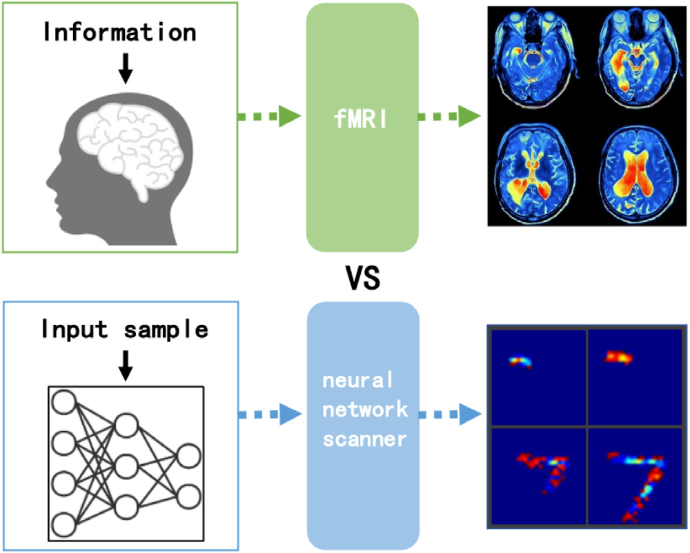

# 1. Introduction

Artificial Neural Networks (ANNs) are among the most widely used artificial intelligence methods nowadays (Bodria et al., 2021; Zhou, Sun, Bau, & Torralba, 2018). However, despite their success in various applications, the interpretability of ANN models remain an open problem and the decision-making process is unreliable in many practical applications (Bau, Zhou, Khosla, Oliva, & Torralba, 2017; Rudin et al., 2021). In some areas that require high precision and reliability in decision-making, e.g., medical treatment (Zhang, Xie, Xing, McGough, & Yang, 2017; Zhu, Ma, Yuan, & Zhu, 2022), autonomous driving (Kim & Canny, 2017; You, Leskovec, He, & Xie, 2020) and criminal justice (Liang, Li, Yan, Li, & Jiang, 2021; McGough, 2018), every decision must have sufficient evidences and convincing reasons. However, ANN models were historically regarded as “black box” models. In the whole process, users do not understand the basis for the judgment of the result, nor can they judge whether the results produced by the model are correct (Lipton, 2018). Therefore, it is difficult for users to completely trust and rely on decisions made by the model (Ghorbani, Abid, & Zou, 2019) and it is necessary to add an interpretation module into the neural network model to explain how it works (Nam, Gur, Choi, Wolf, & Lee, 2020).

Visualizing features learned by individual neurons is an important way to understand the working mechanism of neural networks. There are different architectures of ANNs, e.g., Fully Connected Networks (FCNs) and Convolutional Neural Networks (CNNs). Some of their components have the ability to localize objects, e.g., the convolutional layer and the pooling layer, while others have no localization ability, e.g., the fully-connected layer (Peng et al., 2021; Zhou, Khosla, Lapedriza, Oliva, & Torralba, 2016). There are several methods to visualize the learned features of the components with localization ability (Zhang, Tiňo, Leonardis, & Tang, 2021). However, it is hard to know the information that the components without localization ability have learned. This makes it difficult to compare the output results of different types of components.

In this paper, we propose a method named Neural Network Scanner (NNS). It is used to visualize neuron learning results for different types of neural networks. The features learned by individual neurons can be combined flexibly to analyze different components of the neural network. The results of different components are visualized in a unified way. So we can compare the differences in the operating mechanisms of different models. In the medical field, researchers use external devices (e.g., the functional magnetic resonance imaging (fMRI)) to capture images of the brain and determine the activations of cerebral neurons. After the human brain receives information, fMRI captures the changes in hemodynamics caused by neuron activities. As the fMRI scans human brains, the proposed NNS is a method to scan ANN models. Given an ANN model and an input sample, NNS gets the features learned by each neuron of the neural network. We retain useful information for the neural network interpretation from the learned features of individual neurons. The working principle of the fMRI and the NNS are illustrated in Fig. 1.

*Fig. 1. As the fMRI scans the human brain, the proposed NNS is a method to scan the ANN model. After the human brain receives information, fMRI captures the changes in hemodynamics caused by neuron activities. Given an ANN model and an input sample, NNS gets the features learned by each neuron of the model.*

The contributions of the proposed method can be summarized as follows:

- NNS visualizes the learning process of neurons. It is used to show features learned by each neuron in a human-understandable form. During the operation, NNS keeps the object localization ability.
- NNS is neuron-based. The learned features of individual neurons are combined flexibly to analyze the working mechanism of different components of the neural network. As the results of different components are visualized in a unified way, NNS is applicable to the neural network composed of artificial neurons without requiring architecture changes. Experiments on different neural network architectures (FCNs and CNNs) are performed to show the results of the proposed method. We discuss the differences of the operating mechanisms of different architecture models.
- Several experiments are conducted to evaluate the interpretability of CNNs. We demonstrate the effectiveness of the proposed method by evaluating the features obtained in a layer. Then, we evaluate the interpretability of the highly activated neurons. Finally, we compare the visualization results of NNS with existing approaches.

The rest of the paper is organized as follows. Section 2 gives a brief summary of the related work, where we review the neural network interpretation methods from different perspectives. In Section 3, we introduces the principle of NNS. We propose the concept of the “learning image” and the process of using the learning image to explain the neuron information. To demonstrate the applicability of our method, we apply our method to a collection of models with different neural network architectures in Section 4. Experiments are provided for scanning an FCN, a simple CNN and a ResNet in order to analyze their operating mechanism. Then, NNS is applied to different CNN models for evaluating interpretability from different perspectives. Finally, we summarize this paper and discuss the future work in Section 5.
