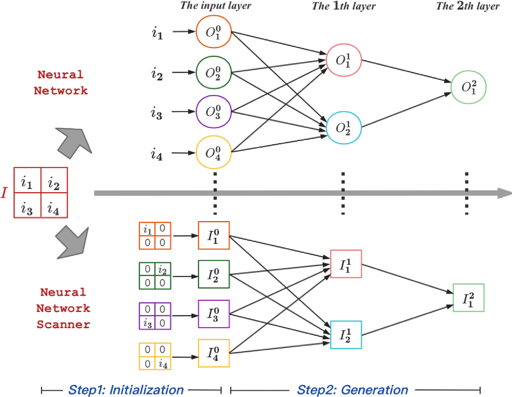
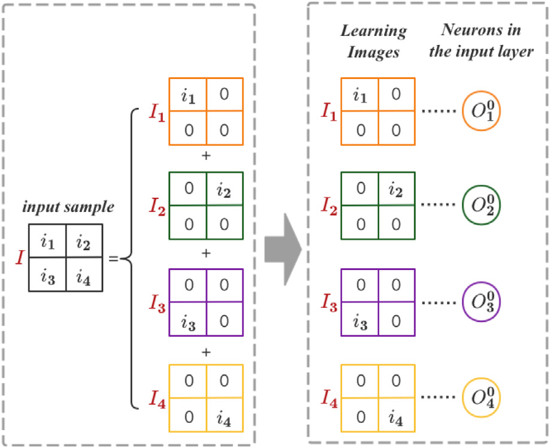
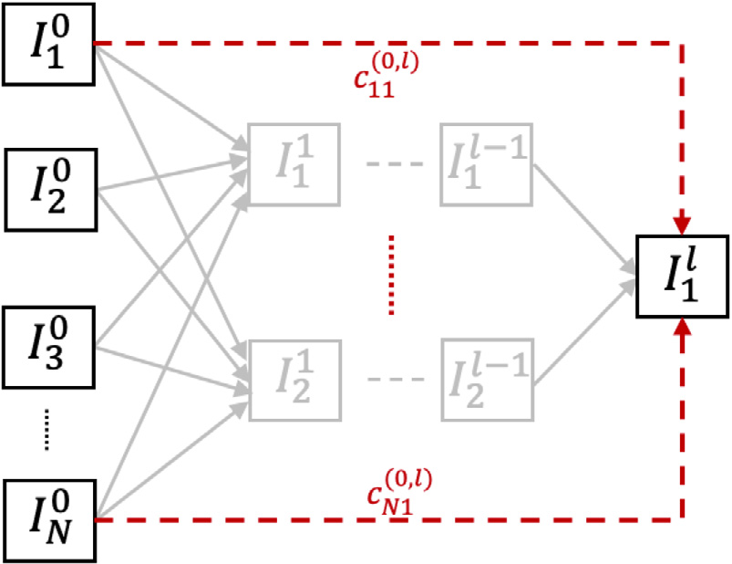
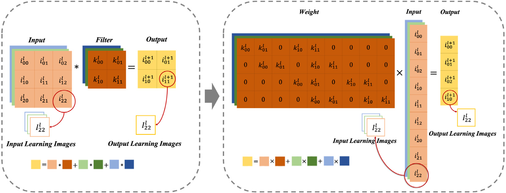

# 3. The proposed method

We propose NNS which scans the neural network and visualizes each neuron in the model. For an input sample, the location information of objects in the image is as important as the value information. In the fully-connected layer, only the value information is used, while the location information is discarded. This makes the fully-connected layer lack the ability to locate objects. The location information is preserved in NNS. We generate an input-resolution image for each neuron which is called the “learning image” of this neuron. The learning image of a neuron is a representation of the features it has learned from the input sample. The generation procedure of learning images for different neurons is illustrated in Fig. 2.



*Fig. 2. The working procedure of NNS. NNS visualizes the neural network at the neuron level. Here we set the dimension of the input sample to be 4. The neurons and the corresponding learning images are connected by a dotted line and in the same color. (1) Initialization: we construct the learning image based on the input sample for each neuron in the input layer. In the neural network, elements of $I$ are values of the input neurons. In NNS, we generate several images based on $I$. Each image keeps a part of the value information and the location information of $I$. These images are distributed to the input neurons as their learning images. (2) Generation: we generate learning images for neurons in hidden layers and the output layer. We calculate the contributions of the input neurons to the specified neuron. Then the learning image of this neuron is generated based on the learning images of the input neurons.*

The workflow of NNS is listed as follows:

- **Learning image initialization.** In this step, we construct the learning image based on the input sample for each neuron in the input layer. We split the input image into several images. Each splitted image keeps a part of the features of the input sample. The features include the value information and the location information. Then the splitted images are assigned to the input neurons in turn.
- **Learning image generation.** In this step, we generate the learning images for all neurons in the hidden layers and the output layer. By obtaining the contributions of the input neurons to the specified neuron, the learning image of this neuron is generated based on the learning images of the input neurons. Throughout the whole process, NNS always keeps the ability to locate the object.

Next, we discuss the detailed steps of NNS.

## 3.1. Learning image initialization

In NNS, the value and the location information of each pixel in the input image is used in the input learning image. As shown in Fig. 3, we construct the learning images for neurons in the input layer.



*Fig. 3. Learning image initialization. We take a 4-dimensional input sample as an example. First, we split the input sample into 4 images with the same dimension. Each splitted image contains a part of the features of the original input sample. Second, we distribute splitted images to neurons in the input layer as their learning images.*

### 3.1.1. Split the sample

First, we regard the input sample as the vector $I=[i_1 i_2 ldots i_N]^T$. The dimension of the input sample $I$ is $N$, where we set $N$ as 4 in Fig. 3. We split the input sample $I$ into $N$ images $I_1,I_2,ldots,I_p,ldots,I_N$:

$$
I=sum_{pin[1,N]} I_p. 	ag{1}
$$

The $p$th splitted image $I_p$ is an image whose pixel values are all 0 except for the $p$th pixel. The $p$th pixel value of $I_p$ is equal to the $p$th pixel value of the input sample $I$. The $p$th splitted image is represented as follows:

$$
I_p(x)=egin{cases}
i_p, & 	ext{if }x=p,\
0, & 	ext{otherwise},
end{cases} 	ag{2}
$$

where $x$ means the pixel number of the image $I_p$ and $xin[1,N]$. Each splitted image contains a part of the features of the original input sample, and preserves the location information corresponding to the features.

### 3.1.2. Distribute learning images

In NNS, we set a learning image for each neuron in the model. Given the input image $I$, we distribute the splitted images to neurons in the input layer. For the $p$th input neuron $O_p^0$, its value is $x_p^0$ and its learning image is $I_p^0$. We assign the splitted images to input neurons in turn. So the $p$th neuron $O_p^0$ is associated with the $p$th splitted image $I_p$:

$$
I_p^0=I_p,qquad pin[1,N]. 	ag{3}
$$

If the input sample is an RGB image, this sample is regarded as an independent image in each channel. The image is split in each channel. We get $3	imes N$ splitted images. They are assigned to input neurons in turn as the learning images.

With the above analysis, we present the step of the learning image initialization in Algorithm 1.

**Algorithm 1 — Learning Image Initialization**

```text
Initialization: I = [i₁ i₂ ... iₙ]ᵀ is the input sample, Iₚ⁰ ∈ ℝᴺ is the
learning image of the pth neuron Oₚ⁰ in the input layer.
set p = 1.
repeat
    set Iₚ ∈ ℝᴺ, Iₚ = [0 0 ... 0]ᵀ
    Iₚ(p) = iₚ
    Iₚ⁰ = Iₚ
    p = p + 1
until p = N
```

## 3.2. Learning image generation

In this step we generate the learning images for neurons in hidden layers and in the output layer. We calculate the contributions of the input neurons to the specified neuron. Then the learning image of this neuron is generated based on the learning images of the input neurons. The procedure for generating the learning images is illustrated in Fig. 4.



*Fig. 4. Learning image generation. We generate the learning images for neurons in hidden layers and the output layer. We calculate contributions of the input learning images to the specified learning image. Then the learning image is generated based on the input learning images.*

### 3.2.1. Learning image generation in the special case

The weight value is regarded as the contribution value to calculate the learning image in the second layer. We take the $q$th neuron in the second layer as an example. We set $c_{pq}^{(0,1)}$ as the contribution value of the $p$th learning image in layer 0 (the input layer) to the $q$th learning image in layer 1 (the second layer). The contribution value $c_{pq}^{(0,1)}$ is equal to the weight value between the $p$th neuron and the $q$th neuron. The learning image becomes $I'=[i_1' i_2' ldots i_N']^T$ through the linear transformation:

$$
I'=sum_{pin[1,N]} c_{pq}^{(0,1)}	imes I_p^0. 	ag{4}
$$

The $t$th pixel value of $I'$ is calculated as:

$$
i_t'=sum_{pin[1,N]} c_{pq}^{(0,1)}	imes i_{pt}^0, 	ag{5}
$$

where $i_{pt}^0$ is the $t$th pixel value of $I_p^0$. After the linear transformation, the features learned by neurons are saved with the location information in NNS.

Then, a non-linear transformation is applied to neurons through a non-linear activation function $f$. In this paper, we set ReLU as the activation function. The $q$th learning image in the second layer is $I_q^1$, which is set as follows:

$$
I_q^1=egin{cases}
I', & 	ext{if }x'>0,\
0, & 	ext{otherwise},
end{cases} 	ag{6}
$$

where $x'$ is the value of the neuron. If $x'$ is greater than 0, the neuron is activated. So its learning image is activated too. If the value of the neuron is 0 after $f$, the neuron is not activated. The contribution of this neuron to neurons in the next layer is zero. So its learning image is 0 and does not contribute to the learning images in the next layer.

The algorithm of the learning image generation in the special case is shown in Algorithm 2.

**Algorithm 2 — Learning Image Generation in the Special Case**

```text
Initialization: Iₚ⁰ is the learning image of neuron p in layer 0, x_q¹ is the
value of neuron q in layer 1, c_pq^(0,1) is the contribution value of the pth
learning image to the qth learning image, w_pq is the weight between p and q,
the input neuron number is m, the output neuron number is n.
set p = 1, q = 1, c_pq^(0,1) = w_pq.
repeat
    I′ ∈ ℝᴺ
    repeat
        I′ = I′ + c_pq^(0,1) × Iₚ⁰
        p = p + 1
    until p = m
    if x_q¹ > 0 then
        I_q¹ = I′
    else
        I_q¹ = 0
    end if
until q = n
```

### 3.2.2. Learning image generation in the general case

Up to now, we have introduced the generation of the learning image in the second layer. For the learning image in other layers, we obtain the contributions of the input learning images to this learning image. In FCN, the weight matrix between the layer $l-1$ and the layer $l$ is $W^linmathbb{R}^{n	imes m}$:

$$
W^l=egin{bmatrix}
w_{11}^l & w_{12}^l & cdots & w_{1m}^l\
dots & dots & ddots & dots\
w_{n1}^l & w_{n2}^l & cdots & w_{nm}^l
end{bmatrix}, 	ag{7}
$$

where $n$ is the neuron number of layer $l$ and $m$ is the neuron number of layer $l-1$. The contribution matrix of the learning images in layer $l-1$ to the learning images in layer $l$ is $C^{(l-1,l)}inmathbb{R}^{n	imes m}$:

$$
C^{(l-1,l)}=egin{bmatrix}
c_{11}^{(l-1,l)} & c_{12}^{(l-1,l)} & cdots & c_{1m}^{(l-1,l)}\
dots & dots & ddots & dots\
c_{n1}^{(l-1,l)} & c_{n2}^{(l-1,l)} & cdots & c_{nm}^{(l-1,l)}
end{bmatrix}. 	ag{8}
$$

In order to achieve non-linear transformation, we use a piecewise linear function $S$ as follows:

$$
S(x)=egin{cases}
1, & 	ext{if }x>0,\
0, & 	ext{otherwise}.
end{cases} 	ag{9}
$$

The contribution value $c_{pq}^{(l-1,l)}$ that the $p$th learning image in layer $l-1$ contributes to the $q$th learning image in layer $l$ is calculated as follows:

$$
c_{pq}^{(l-1,l)}=S(x_q^l)w_{pq}^l, 	ag{10}
$$

where $x_q^l$ is the value of the $q$th neuron in layer $l$. The contribution matrix of the input learning images to the $q$th learning image $I_q^l$ in layer $l$ is represented as $C_q^{(0,l)}$:

$$
C_q^{(0,l)}=W_q^lcdotprod_{i=1}^{l-1}C^{(i-1,i)}, 	ag{11}
$$

where $W_q^linmathbb{R}^{1	imes m}$ is the weight matrix between layer $l-1$ and the $q$th neuron in layer $l$.

All the input learning images are represented as a matrix $I_{sum}^0inmathbb{R}^{N	imes N}$:

$$
egin{aligned}
I_{sum}^0&=(I_1^0,I_2^0,ldots,I_N^0)\
&=egin{bmatrix}
i_{11}^0&i_{21}^0&cdots&i_{N1}^0\
dots&dots&ddots&dots\
i_{1N}^0&i_{2N}^0&cdots&i_{NN}^0
end{bmatrix},
end{aligned} 	ag{12}
$$

where $N$ is the input learning image number. The $q$th learning image in layer $l$ is $I_q^l$:

$$
I_q^l=I_{sum}^0cdot C_q^{(0,l)}. 	ag{13}
$$

Carrying out this process, we obtain the learning images for all neurons.

## 3.3. Additional discussion on CNN

In the fully-connected layer, the output neurons apply a linear transformation to the input neurons through a weights matrix. With an artificial neuron as the fundamental unit, various types of neural network layers can be transformed into fully-connected layers. We take CNN as an example. The equivalence relationship between the convolutional layer and the fully-connected layer is shown in Fig. 5. The outputs of a convolutional layer are feature maps. Neurons in the same feature map correspond to the same convolution filter, i.e., these neurons share the same weights. The numerical matrix of a filter can be converted to a weight matrix between two layers. The convolution operation is equivalent to the linear operation. In the pooling layer, neurons in the feature maps are screened, which can be regarded as a special convolution process. Therefore, a pooling layer is also equivalent to a fully-connected layer. We regard each unit (pixel) in the convolutional and pooling layers as a neuron and build the learning image for each neuron. The learning image of the neuron changes as the value of the neuron changes. Neurons in the pooling layer are selected from the previous layer. During this process, the values of the neurons do not change. The learning images of these selected neurons are collected from the previous layer and stay the same.



*Fig. 5. The equivalence relationship between convolution and linear operations. Neurons in the same feature map correspond to the same convolution filter, i.e., these neurons share the same weights. The numerical matrix of a filter can be converted to a weight matrix between two layers. The convolution operation is equivalent to the linear operation. Then, we obtain the learning images in the convolutional layer in the way of calculating the learning images in the fully-connected layer.*

The size of the input image is $M	imes M	imes D$. First, we split the input image into $M	imes M$ images. For one unit $(x,y)$, its splitted image is $I_{(x,y)}inmathbb{R}^{M	imes M	imes D}$. In each channel, the splitted image is generated as discussed in Section 3.1.1. Then the splitted images is distributed to each neuron in the input layer as discussed in Section 3.1.2:

$$
I_{(x,y)}^0=I_{(x,y)},qquad x,yin[1,M]. 	ag{14}
$$

As shown in Fig. 5, we convert the convolution and pooling operations into linear operations, and then obtain the learning images in the convolutional and pooling layers in the same way as calculating the learning images in the fully-connected layer. In the whole process, the size of the learning images is $M	imes M	imes d$, where $d$ is the channel number of the corresponding neuron. In this way, the learning images for neurons in CNN can be obtained.
