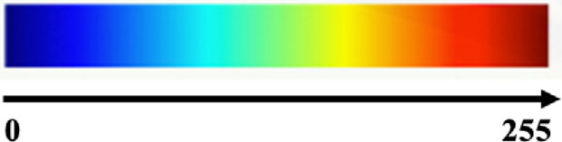
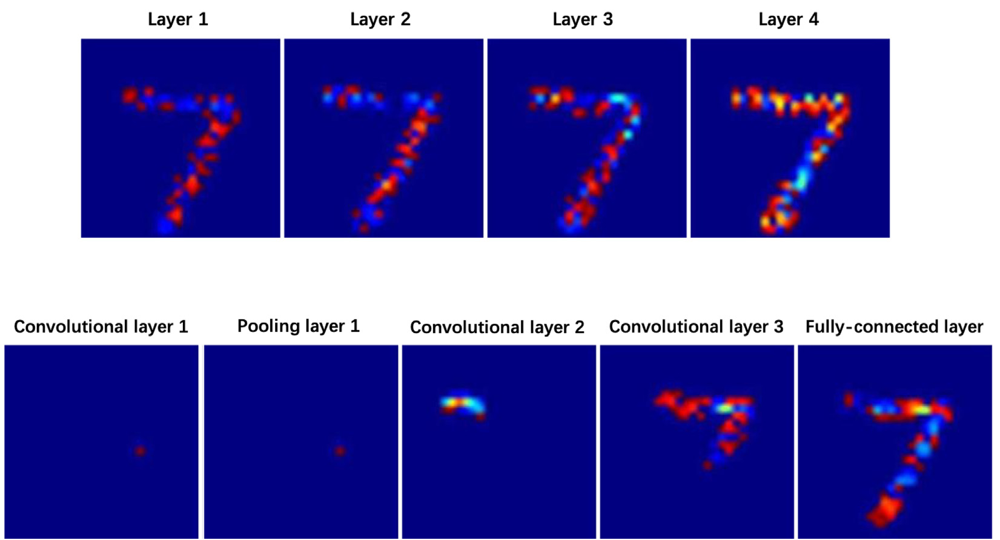
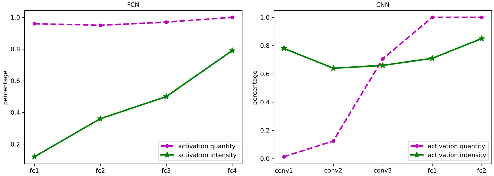
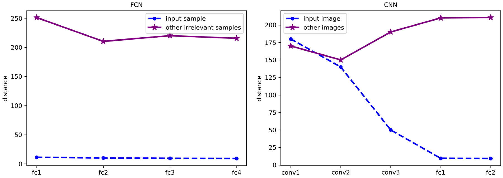
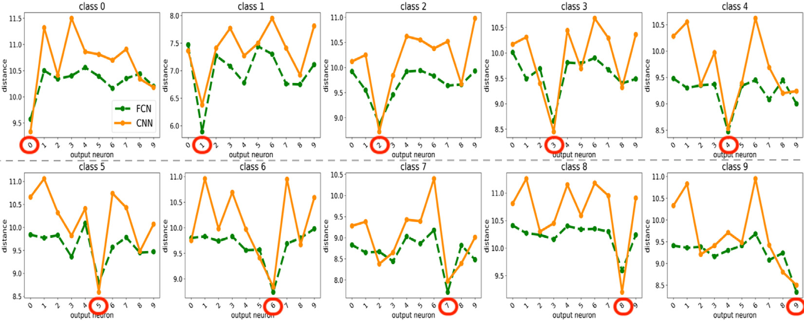
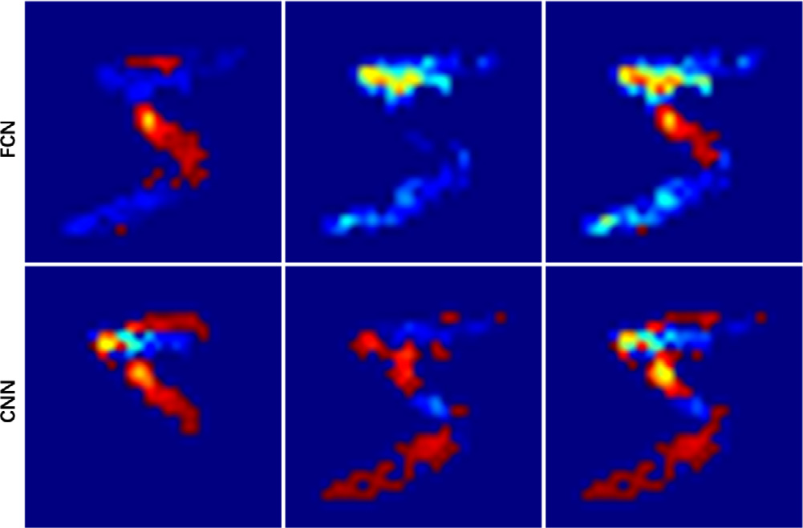
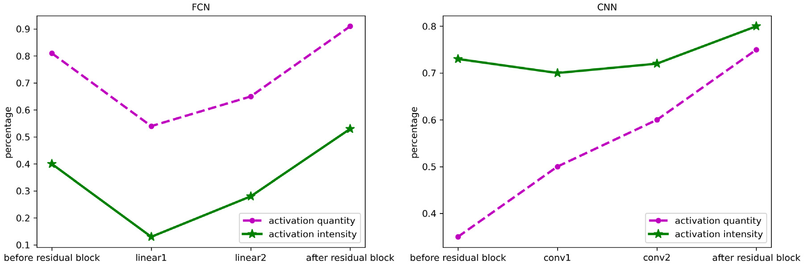
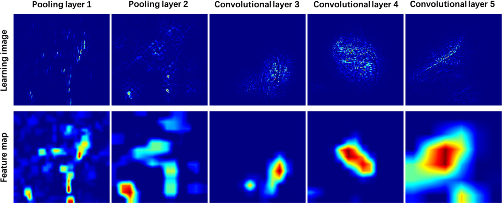
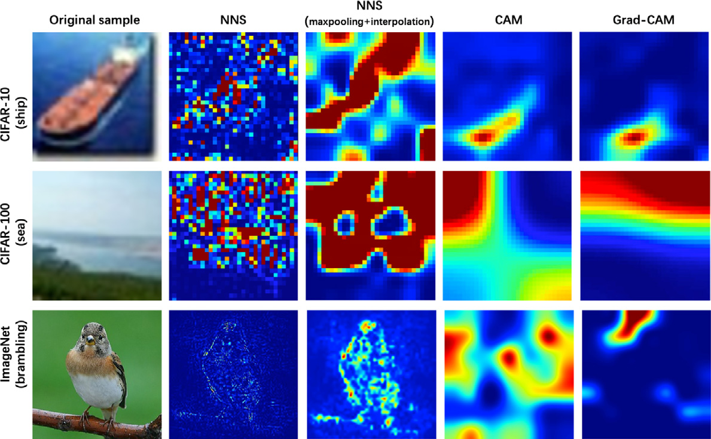

# 4. Experiments

In CNN, we regard each unit of the feature maps as a neuron. In order to clearly distinguish different pixel intensities in the images, we use the form of heat map to represent the image. The heatmap uses different colors to represent different pixel intensities. The colormap of the heatmap is shown in Fig. 6. The larger the pixel value is in the image, the closer the color of the pixel is to “red”. The smaller the pixel value is, the closer the color of the pixel is to “blue”. To demonstrate the applicability of our method, we apply our method to a collection of models with different neural network architectures. The detailed description of the neural network are shown in Table 1. In Section 4.1, the neural networks with and without skip connections are trained on MNIST. In Section 4.2, the models are trained on ImageNet, CIFAR-10 and CIFAR-100. All models are trained by backpropagation (BP) learning algorithm.

*Fig. 6. The colormap of the heatmap.*

**Table 1. The detailed description of neural networks.**

| Architecture | Dataset | Learning algorithm |
|---|---|---|
| FCN | MNIST | BP |
| CNN | MNIST | BP |
| FCN with skip connections | MNIST | BP |
| ResNet10 | MNIST | BP |
| AlexNet | ImageNet | BP |
| VGGNet | CIFAR-10, CIFAR-100 | BP |

## 4.1. Scanning different neural network architectures

To analyze the differences of the operating mechanisms of different architecture models, we perform experiments on an FCN model and a simple CNN model. The FCN model used here has an input layer (784 neurons), two hidden layers (500 neurons) and an output layer (10 neurons). The simple CNN consists of three convolutional layers (10 filters), two pooling layers, a flatten layer, a fully-connected layer (64 neurons) and an output layer (10 neurons). We choose a simple dataset so that different models are trained well. Both models are trained on the MNIST handwritten digits training set.

In the following experiments, first we verify the effectiveness of the proposed method on different neural networks and analyze their operating mechanisms. Second, we clarify the neuron learning rules for different models. Then, we explore the nature of the features learned by the winning neuron. Finally, we compare the learning process between different architectures with skip connections.

### 4.1.1. Operating mechanism comparison

In this part, we compare operating mechanisms of different models. Visualizing all neurons of a trained neural network can gain an insight into the operation of the model. Given the same input sample, we select one activated neuron in each layer to show its learning image. The scanning results from each layer show the layered characteristics of neural network learning. In FCN, we observe from Fig. 7(a) that the network always learns global features in each layer. For each neuron, we see the edge outlines of the input sample. In layer 1, the features learned by FCN are represented by only two colors in the learning images. In layer 3, the learned features are represented by multiple colors. The low-level layers learn monotonous features with small color changes in the learning images. The high-level layers learn abundant features with big color changes in the learning images. In CNN, we observe that the network always learns abundant features with big color changes in each layer. As shown in Fig. 7(b), in low-level layers (the first and second convolutional layers), only a few neurons are activated. The low-level layers respond to features in the small part of the image. The convolutional layer 3 learns features in a larger part. The neurons in the pooling layer are selected from the neurons in the previous convolutional layer. The values of the selected neurons do not change, so the learning images of the selected neurons remain the same. The fully-connected layer in CNN learns global features as well.

*Fig. 7. The visualization of the learning process of neurons. (a) NNS for FCN: the neural network always learns global features in each layer. The low-level layers learn monotonous features with small color changes in the learning images. The high-level layers learn abundant features with big color changes in the learning images. (b) NNS for CNN: the convolutional layer 1 and layer 2 respond to simple features such as corners and edge conjunctions. The convolutional layer 3 learns more complex features. As neurons in the pooling layer are selected from neurons in the previous convolutional layer, the learning images of neurons do not change.*

We analyze the learning images by measuring the knowledge quantity learned by neurons in each layer. The knowledge quantity is evaluated from two aspects: the activation quantity and the activation intensity. For one learning image, the activation quantity is the number of activation pixels, the activation intensity is the sum of the pixel intensity. For comparison purposes, the activation quantity of one layer is set as the percentage of the average activation quantity of all neurons to the activation quantity of the input image. Similarly, the activation intensity of one layer is set as the percentage of the average activation intensity of all neurons to the activation intensity of the input image. The larger the activation quantity and the activation intensity, the more knowledge the neural network learns from the input samples.

Fig. 8 shows the knowledge quantity of FCN and CNN. As shown in Fig. 8(a), the activation quantity of each layer always keeps at a very high value in FCN. The activation intensity increases significantly with the increase of the number of layers. As shown in Fig. 8(b), the activation quantity of the convolutional layer increases with the increase of the number of layers. Comparing with activation intensities of other convolutional layers, the activation intensity of the first convolutional layer has the largest value. Activation intensities of other convolutional layers do not change significantly. In CNN, the changing trend of the knowledge quantity at the fully-connected layer is similar to that of the fully-connected layer in FCN.

*Fig. 8. Comparisons of the knowledge quantity of FCN and CNN in each layer. In FCN, changes of the knowledge quantity is mainly realized by changes of the activation intensity. In CNN, changes of the knowledge quantity are mainly achieved through changes of the activation quantity.*

Through experiments, we analyze the working mechanism of FCN and CNN. In FCN, we observe that changes of the knowledge quantity are mainly realized by changes of the activation intensity. Although global features have been learned in the first layer, they are only preliminary features. With the number of layers increases, the activation intensity of the learning image becomes large. The complexity of the features learned by FCN at the same position of the image increases with the increase of the number of layers. In CNN, we observe that changes of the knowledge quantity are mainly achieved through changes of the activation quantity. Neurons in the low-level layers learn simple local features and neurons in the high-level layers learn complex global features.

### 4.1.2. Neuron learning rules

In order to clarify the features that neurons pay attention to, we obtain the similarity between the learning images and the samples in the dataset. We compare the similarity of the learning image to the corresponding input sample with the similarity of the learning image to other irrelevant samples. We measure the similarity between two images by calculating the distance between them. The distance between the input sample $I$ and the learning image $I_o$ of the neuron $o$ is calculated as follows:

$$
dist_o^I=lVert I_o-I
Vert. 	ag{15}
$$

The larger the distance, the lower the similarity between images, and vice versa. As shown in Fig. 9, we calculate the distance between the learning image and its corresponding input sample. For comparison and analysis, we calculate the distance between the same learning image and other irrelevant samples.

*Fig. 9. The similarity between the learning images and the samples in the dataset. We compare the similarity of the learning image to the corresponding input sample with the similarity of the learning image to other irrelevant samples. The larger the distance, the lower the similarity between images, and vice versa. The features learned by neurons in the fully-connected layer always maintain a high similarity with the features in the input samples in each layer. Neurons in the convolutional layer tend to learn fixed features while this property decreases as the number of layers increases.*

In FCN, as shown in Fig. 9(a), regardless of the layer, the distance between the learning image and other irrelevant samples is far greater than the distance between the learning image and its input sample. Neurons in the fully-connected layer have no fixed learning features. The features learned by neurons always have a very large relationship with the input sample.

In CNN, as the pooling operation does not change the learning images of neurons, we only show the learning images of neurons in the convolutional layers and the fully-connected layers. As shown in Fig. 9(b), in the convolutional layer 1 and the convolutional layer 2, the distance between the learning image and other irrelevant samples is similar to the distance between the learning image and the input image. Neurons in the low-level convolutional layer tend to learn fixed features. In the convolutional layer 3, the distance between the learning image and the input image is smaller than the distance between the learning image and other irrelevant samples. Compared with the learning image of the low-level convolutional layer, the learning image of the high-level convolutional layer is more similar to the input image. The changing trend of the learning images of neurons in the fully-connected layer is similar to that of the fully-connected layer in FCN.

Through experiments, we analyze the learning rules of different neural network architectures. The features learned by neurons in the fully-connected layer always maintain a high similarity with the features in the input samples in each layer. The features learned by neurons in the fully-connected layer are not fixed and change with the input sample. Neurons in the fully-connected layer learn global features and obtain global contour information, which is the obvious difference between the specified input sample and other irrelevant samples. Neurons in the convolutional layer tend to learn fixed features while this property decreases as the number of layers increases. Neurons in the low convolutional layer are interested in the specified local features in a small part of the image. These features bear little relationship with the global contour of the input sample. In the high-level convolutional layer, neurons learn more complex features in a larger part. The similarity between the learned features and the input sample becomes larger.

### 4.1.3. Winning neuron analysis

In this experiment, we explore how discriminative the features in the output layer of the neural networks are. For the same input sample, we compare the abilities to restore the input sample of the different neurons in the output layers. The winning neuron is the output neuron corresponding to the correct class. The distance between the input sample $I$ and the learning image $I^o$ of the specified output neuron $o$ is calculated as that in Eq. (15). All the input samples belonging to class $c$ are $I^c$. The distance between $I^c$ and a specified neuron $o$ is represented as the average of the distance between each sample in class $c$ and the neuron $o$:

$$
DIST_o^c=rac{sum_{Iin I^c}dist_o^I}{N}, 	ag{16}
$$

where $N$ is the input sample number of class $c$.

The distances between the input samples and the learning images of the output neurons are shown in Fig. 10. In the $c$th subgraph, the distances between the input samples belonging to class $c$ and the different output neurons are shown. The distance is minimum when $o=c$. Compared with the learning images of other output neurons, the learning image of the winning neuron is closer to the input sample for both FCN and CNN in each subgraph. The features learned by the winning neuron are the most similar to the input sample. In other words, compared with other neurons in the output layer, the winning neuron recovers the input sample better.

*Fig. 10. The distances between the input samples and the learning images of the output neurons. The $c$th subgraph presents the distances between the input samples belonging to class $c$ and the different output neurons. In each subgraph, compared with the learning images of other output neurons, the learning image of the winning neuron is closer to the input sample in both FCN and CNN. The features learned by the winning neuron are the most similar to the input sample. In other words, compared with other neurons in the output layer, the winning neuron recovers the input sample better.*

In order to analyze the property of the winning neuron, we measure winning neurons on three neural networks with different accuracies for both FCN and CNN in Table 2. First we analyze the relationship between distance and accuracy. The distance between the learning images of winning neurons and input samples is shown. For both FCN and CNN, the higher the accuracy of the model, the smaller the distance. In other words, the features learned by the neural network with higher accuracy are more similar to input sample. Then we measure the activation intensity and activation quantity of winning neurons’ learning images. As Table 2 shows, for winning neurons of both FCN and CNN, the activation intensity increases with the increase of model accuracy. The activation quantity is always 1 in different neural network for FCN. The activation quantity increases with the increase of accuracy and always keeps a high value for CNN. For both FCN and CNN, winning neurons of neural networks with different accuracies all obtain global feature information. The winning neuron of the neural network with higher accuracy learns features with higher activation intensity.

**Table 2. The results of winning neurons.**

| Metric | FCN 40 | FCN 70 | FCN 90 | CNN 40 | CNN 70 | CNN 90 |
|---|---:|---:|---:|---:|---:|---:|
| Accuracy | 40 | 70 | 90 | 40 | 70 | 90 |
| Distance | 9.10 | 8.84 | 8.47 | 8.91 | 8.52 | 8.35 |
| Activation intensity | 0.589 | 0.648 | 0.665 | 0.427 | 0.453 | 0.678 |
| Activation quantity | 1.0 | 1.0 | 1.0 | 0.995 | 0.996 | 0.998 |

### 4.1.4. Architectures with skip connections

In this part, we compare the learning process between different architectures with skip connections. We design experiments on a fully-connected architecture with one residual block and a ResNet10 model. We compare the learning images of neurons before the residual block, in the residual block and after the residual block. Changes in the learning images of neurons at the same location are shown in Fig. 11. Neurons in the residual block learn features that are different from the features learned by neurons before the residual block. Fig. 12 shows the knowledge quantity of different architectures with skip connections. For FCN, the activation quality and the activation intensity of neurons in the residual block are lower than those before the residual block. After adding the residual block, both the activation quality and the activation intensity of neurons increase significantly. For CNN, the activation quality always maintains a growing trend. The activation intensity in the residual block decreases compared to those before the residual block. After adding the residual block, the activation quality increases significantly and the activation intensity has a slight increase. For both FCN and CNN, residual blocks increase the knowledge quantity of the neural networks.

*Fig. 11. Comparisons of a fully-connected architecture with skip connections (top) and a convolutional architecture with skip connections (bottom). The learning images of neurons before the residual block (left), in the residual block (middle), after the residual block (right).*

*Fig. 12. Comparisons of the knowledge quantity between different architectures with skip connections. For FCN, the activation quality and the activation intensity of neurons in the residual block are lower than those before the residual block. After adding the residual block, both the activation quality and the activation intensity of neurons increase significantly. For CNN, the activation quality always maintains a growing trend. The activation intensity in the residual block decreases compared to those before the residual block. After adding the residual block, the activation quality increases significantly and the activation intensity has a slight increase.*

## 4.2. Evaluating interpretability of CNNs

In the following experiments, we evaluate the interpretability of CNNs. We use AlexNet and VGGNet as representative models to analyze CNNs. These models are trained on ImageNet. We begin by validating the effectiveness of NNS by evaluating interpretability of the model in a layer. Then, we analyze the learning ability of highly activated neurons in the same layer. Finally, we compare the visualization results of NNS with existing approaches.

### 4.2.1. Evaluating interpretability by layer

We conduct experiments to analyze whether it is meaningful to generate a learning image for individual neurons. The feature map has the ability to localize objects. So we regard the feature map as a baseline. We evaluate the interpretability by measuring the correlation between the learning image and the feature map in a single layer of the CNN model. The learning image of a layer is the sum of the learning images of all neurons in that layer. We find that the learning image of one layer and the corresponding feature map are highly correlated. In other words, the features learned by one layer are the sum of the features learned by all neurons that make up the layer.

The models we used are AlexNet and VGGNet. For the input image, $F^{k,l}$ is the feature map of the filter $k$ in layer $l$. $f_{(x,y)}^{k,l}$ represents the activation value of $F^{k,l}$ at spatial location $(x,y)$. $I_{(x,y)}^{k,l}$ is the learning image of the neuron at $(x,y)$ of $F^{k,l}$. We use $I^{k,l}=sum_{x,y}I_{(x,y)}^{k,l}	imes f_{(x,y)}^{k,l}$ to represent the learning image of the filter $k$ in layer $l$. To compare a low-resolution feature map to the input-resolution learning image, the feature map is scaled up to the mask resolution $S^{k,l}$ from $F^{k,l}$ using bilinear interpolation. The correlation between the feature map and the learning image is reported as:

$$
C^{k,l}=rac{S^{k,l}cap I^{k,l}}{I^{k,l}}. 	ag{17}
$$

Eq. (17) is a variant of intersection over union. As there are more detail features in the learning image than in the feature map, we replace $S^{k,l}cup I^{k,l}$ with $I^{k,l}$ to make the equation more sensitive to changes. The correlation value between the feature map and the learning image in one layer is:

$$
C^l=rac{sum_{kin K}C^{k,l}}{K}, 	ag{18}
$$

where $K$ is the number of filters in the layer. In layer $l$, the larger the $C^l$, the higher the correlation between the feature map and the learning image, and vice versa.

According to the models, different layers are selected to measure the correlations between the feature maps and the learning images. For AlexNet, we choose pooling layer 1, pooling layer 2, convolutional layer 3, convolutional layer 4 and convolutional layer 5. For VGGNet, we choose pooling layer 1, pooling layer 2, pooling layer 3, pooling layer 4 and pooling layer 5.

The correlation performance is shown in Table 3. For convenience, we will describe these layers as layer 1, layer 2, layer 3, layer 4 and layer 5, respectively. For both AlexNet and VGGNet, the feature maps and the learning images always keep a high degree of correlations in different layers. The performance of these two models is comparable. In the low-level layers (layer 1 and layer 2), the consistencies between the feature maps and the learning images are very high. As the feature map is scaled up to the input-resolution using bilinear interpolation. Compared with the learning image, the feature map lacks details. Therefore, in the high-level layers (layer 3, layer 4 and layer 5), the consistency is reduced.

**Table 3. The correlation between the feature map and the learning image.**

| Model | Layer 1 | Layer 2 | Layer 3 | Layer 4 | Layer 5 |
|---|---:|---:|---:|---:|---:|
| AlexNet | 0.998 | 0.872 | 0.641 | 0.634 | 0.623 |
| VGGNet | 0.952 | 0.923 | 0.688 | 0.620 | 0.538 |

Fig. 13 shows the image comparison results of feature maps and their corresponding learning images in each layer in AlexNet. The learning images are highly correlated with their corresponding feature maps. The information in the learning image is more detailed than that in the corresponding feature map. We conclude that the input-resolution learning image shows the features learned by the model. The features learned by one layer are the sum of the features learned by all neurons that make up this layer.

*Fig. 13. The learning images (top) and their corresponding feature maps (bottom) in AlexNet. The learning image and the corresponding feature map are highly correlated in each layer. There is more detailed information in the learning image than the corresponding feature map.*

### 4.2.2. Evaluating interpretability by neurons

By using NNS, we analyze and compare the learning images of neurons in the same convolutional layer. For the input image, we select neurons with top 2 activation values in each convolution result to show their learning images. These neurons are the most representative ones in one layer. We find that the learning images of two representative neurons are highly similar and these neurons tend to learn features at similar locations in the image.

The learning images of two neurons with top 2 activation values of the filter $k$ in layer $l$ are $I_1^{k,l}$ and $I_2^{k,l}$. We use intersection over union to measure the correlation between these two neurons:

$$
IoU^{k,l}=rac{I_1^{k,l}cap I_2^{k,l}}{I_1^{k,l}cup I_2^{k,l}}. 	ag{19}
$$

The correlation value of these neurons in one layer is:

$$
IoU^l=rac{sum_{kin K}IoU^{k,l}}{K}, 	ag{20}
$$

where $K$ is the number of filters in the layer.

The correlations of two neurons with top 2 activation values are summarized in Table 4. Same as previous experiments, different layers are selected to measure the correlations in different models. In the low-level layers (layer 1 and layer 2), the correlations are high. Highly activated neurons tend to learn the same features at a similar location. Although the correlation decreases in the high-level layers (layer 3, layer 4 and layer 5), the features learned by the highly activated neurons still have consistency. The highly activated neurons in VGGNet consistently maintain a high degree of correlations across different layers. The neurons in VGGNet show stronger correlations than those in AlexNet. The highly activated neurons in the low-level layers tend to learn similar features. The learning abilities of neurons in the high-level layers vary significantly among different models.

**Table 4. The learning image correlation of highly activated neurons.**

| Model | Layer 1 | Layer 2 | Layer 3 | Layer 4 | Layer 5 |
|---|---:|---:|---:|---:|---:|
| AlexNet | 0.999 | 0.953 | 0.761 | 0.676 | 0.615 |
| VGGNet | 0.997 | 0.990 | 0.873 | 0.835 | 0.804 |

### 4.2.3. Evaluating visualization result

In this section, we compare NNS with CAM and Grad-CAM. The visual comparison results on CIFAR-10, CIFAR-100 and ImageNet are shown in Fig. 14. For NNS, we show the learning image of the winning neuron in the output layer. The heat map generated by NNS is the same size as the original image. CAM and Grad-CAM generate small-sized heatmaps and then interpolate and enlarge them to the original image size, so their heatmaps are smoother than NNS’s heatmaps. Compared with the large-sized ImageNet dataset, this phenomenon is more significant on the small-sized CIFAR-10 and CIFAR-100. In order to reduce the impact of this phenomenon on the comparison results, we perform max pooling and interpolation on the results of NNS. NNS shows what the model has learned from the input sample and how the model describes the sample. The other algorithms show the regions of interest for the model. On CIFAR-10 and CIFAR-100, NNS displays object feature information. On ImageNet, we see that NNS describes the contours and the important details of the input sample.

*Fig. 14. Comparison of visualization results of different approaches. CAM and Grad-CAM generate small-sized heatmaps and then interpolate and enlarge them to the original image size, so their heatmaps are smoother than NNS’s heatmaps. In order to reduce the impact of this phenomenon on the comparison results, we perform max pooling and interpolation on the results of NNS. On CIFAR-10 and CIFAR-100, NNS displays object feature information. On ImageNet, NNS describes the contours and the important details of the input sample.*
