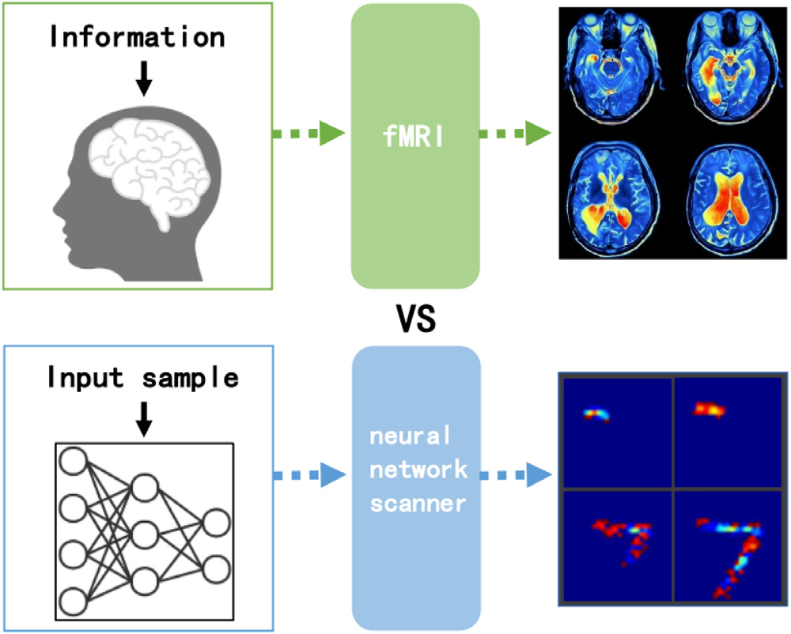

# 1. 引言

人工神经网络（ANN）是当今应用最广泛的人工智能方法之一（Bodria et al., 2021; Zhou, Sun, Bau, & Torralba, 2018）。然而，尽管人工神经网络已在各种应用中取得成功，其模型的可解释性仍是一个悬而未决的问题，而且在许多实际应用中，模型的决策过程并不可靠（Bau, Zhou, Khosla, Oliva, & Torralba, 2017; Rudin et al., 2021）。在一些要求决策具有高精度和高可靠性的领域，例如医疗（Zhang, Xie, Xing, McGough, & Yang, 2017; Zhu, Ma, Yuan, & Zhu, 2022）、自动驾驶（Kim & Canny, 2017; You, Leskovec, He, & Xie, 2020）和刑事司法（Liang, Li, Yan, Li, & Jiang, 2021; McGough, 2018），每项决策都必须有充分的证据和令人信服的理由。然而，人工神经网络模型在历史上一直被视为“黑箱”模型。在整个过程中，用户既不了解结果的判断依据，也无法判断模型产生的结果是否正确（Lipton, 2018）。因此，用户很难完全信任和依赖模型所作出的决策（Ghorbani, Abid, & Zou, 2019），有必要在神经网络模型中加入解释模块，以说明其工作方式（Nam, Gur, Choi, Wolf, & Lee, 2020）。

可视化单个神经元学到的特征，是理解神经网络工作机制的重要途径。人工神经网络有多种架构，例如全连接网络（FCN）和卷积神经网络（CNN）。其中一些组件具备物体定位能力，例如卷积层和池化层；另一些则不具备定位能力，例如全连接层（Peng et al., 2021; Zhou, Khosla, Lapedriza, Oliva, & Torralba, 2016）。目前已有多种方法能够可视化具有定位能力的组件所学到的特征（Zhang, Tiňo, Leonardis, & Tang, 2021）。然而，对于不具备定位能力的组件，我们很难知道它们学到了什么信息。这使得比较不同类型组件的输出结果变得困难。

本文提出一种名为神经网络扫描器（Neural Network Scanner，NNS）的方法，用于可视化不同类型神经网络中神经元的学习结果。单个神经元学到的特征可以灵活组合，用于分析神经网络的不同组件。不同组件的结果以统一方式进行可视化，因此我们可以比较不同模型工作机制之间的差异。在医学领域，研究人员使用外部设备（例如功能性磁共振成像，fMRI）采集脑部图像并确定脑神经元的激活情况。当人脑接收信息后，fMRI 会捕获神经元活动引起的血流动力学变化。正如 fMRI 扫描人脑一样，所提 NNS 是一种扫描人工神经网络模型的方法。给定一个人工神经网络模型和一个输入样本，NNS 可以获得神经网络中每个神经元学到的特征。我们从单个神经元学到的特征中保留有助于解释神经网络的信息。fMRI 与 NNS 的工作原理如图 1 所示。

*图 1. 正如 fMRI 扫描人脑一样，所提 NNS 是一种扫描人工神经网络模型的方法。当人脑接收信息后，fMRI 会捕获神经元活动所引起的血流动力学变化。给定一个人工神经网络模型和一个输入样本，NNS 可以获得模型中每个神经元学到的特征。*

所提方法的贡献可概括如下：

- NNS 对神经元的学习过程进行可视化。它以人类可理解的形式展示每个神经元学到的特征。在运行过程中，NNS 保留物体定位能力。
- NNS 以神经元为基础。单个神经元学到的特征可以灵活组合，用于分析神经网络不同组件的工作机制。由于不同组件的结果以统一方式进行可视化，NNS 可用于由人工神经元构成的神经网络，而无需改变其架构。我们在不同神经网络架构（FCN 和 CNN）上开展实验，以展示所提方法的结果，并讨论不同架构模型工作机制之间的差异。
- 我们开展了多项实验来评估 CNN 的可解释性。首先通过评估一个层中获得的特征证明所提方法的有效性，随后评估高度激活神经元的可解释性，最后将 NNS 的可视化结果与现有方法进行比较。

本文其余部分安排如下。第 2 节简要总结相关工作，从不同角度回顾神经网络解释方法。第 3 节介绍 NNS 的原理，提出“学习图像”的概念以及使用学习图像解释神经元信息的过程。为了证明本方法的适用性，第 4 节将其应用于一组具有不同神经网络架构的模型。我们分别扫描 FCN、简单 CNN 和 ResNet，以分析其工作机制；随后将 NNS 应用于不同的 CNN 模型，从不同角度评估可解释性。最后，第 5 节总结全文并讨论未来工作。
