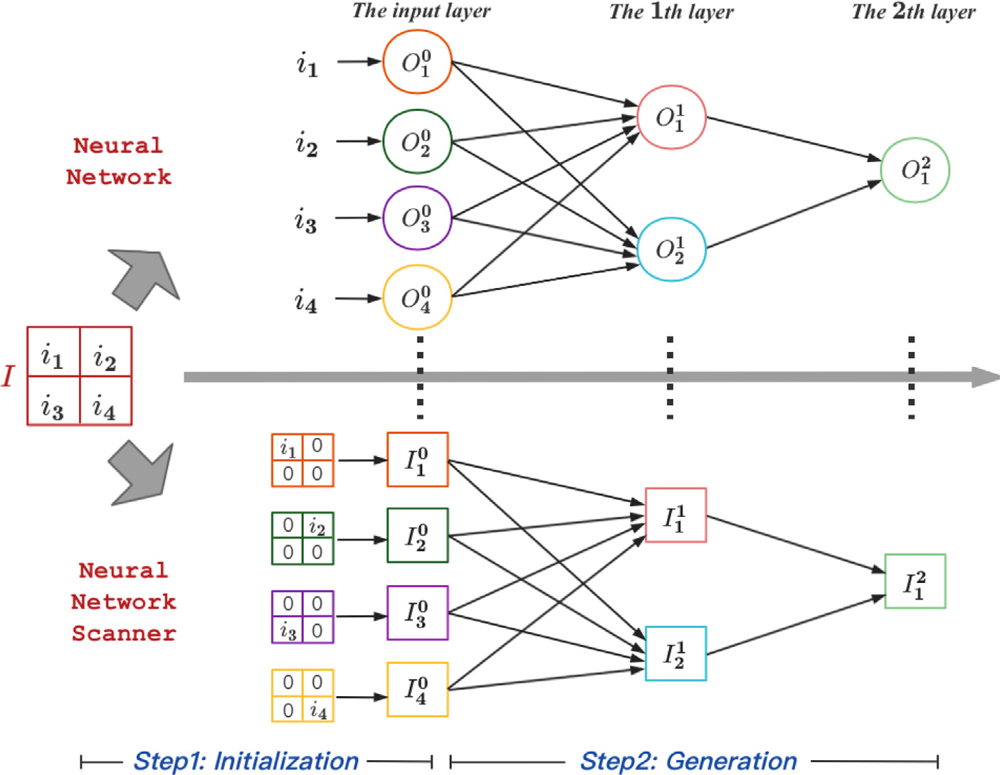
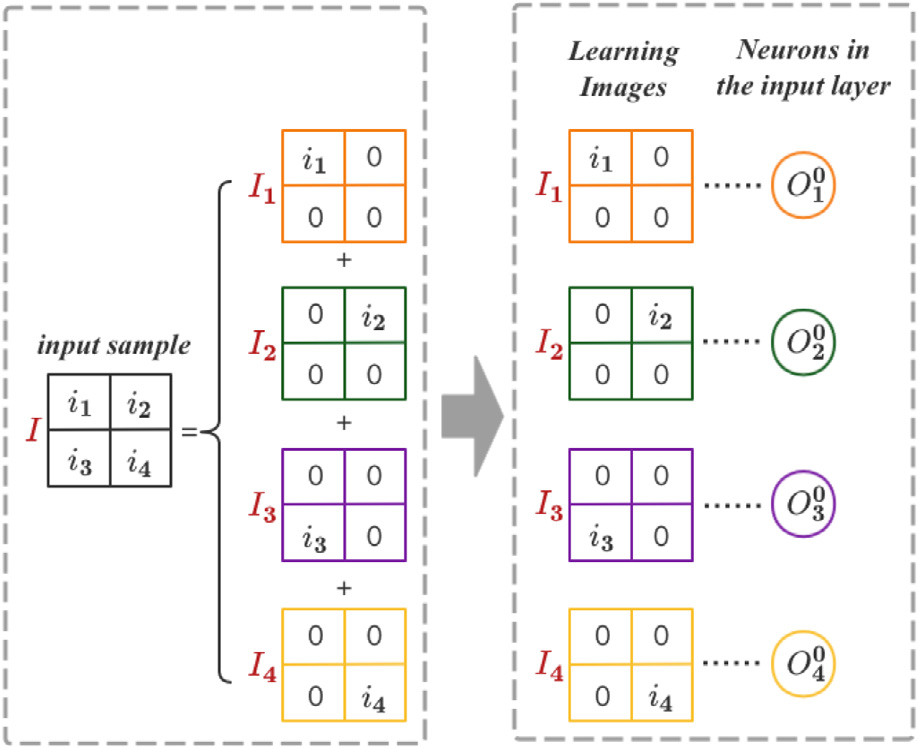
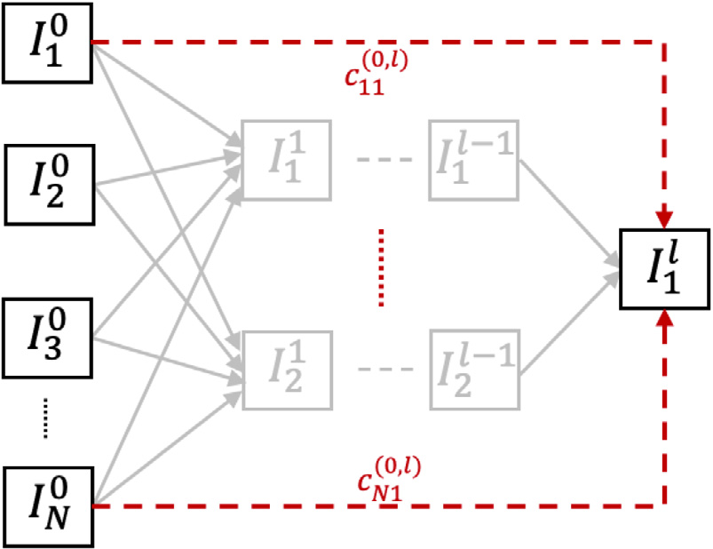
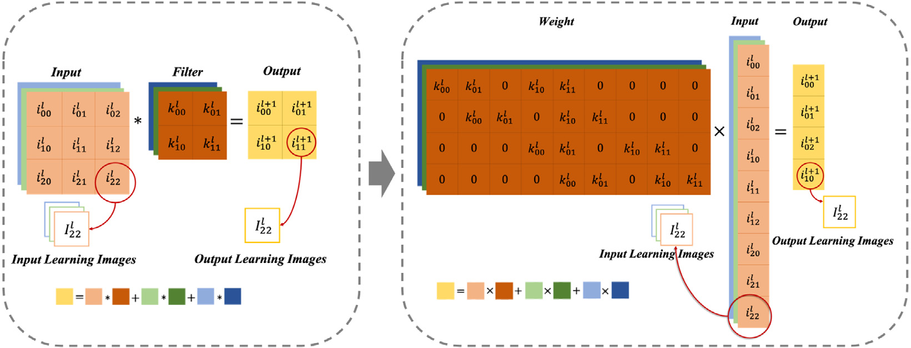

# 3. 所提方法

我们提出 NNS，用它扫描神经网络并可视化模型中的每个神经元。对于一个输入样本，图像中物体的位置信息与数值信息同等重要。在全连接层中，仅使用数值信息，而位置信息会被丢弃，这使全连接层缺乏物体定位能力。NNS 则保留位置信息。我们为每个神经元生成一幅具有输入分辨率的图像，称为该神经元的“学习图像”。神经元的学习图像表示它从输入样本中学到的特征。不同神经元学习图像的生成过程如图 2 所示。



*图 2. NNS 的工作流程。NNS 在神经元层级上对神经网络进行可视化。此处将输入样本的维数设为 4。神经元与相应的学习图像由虚线连接，并以相同颜色表示。（1）初始化：针对输入层中的每个神经元，根据输入样本构造学习图像。在神经网络中，$I$ 的元素是输入神经元的值；在 NNS 中，我们根据 $I$ 生成若干图像。每幅图像保留 $I$ 的部分数值信息和位置信息，并作为学习图像分配给输入神经元。（2）生成：为隐藏层和输出层中的神经元生成学习图像。首先计算输入神经元对指定神经元的贡献，随后根据输入神经元的学习图像生成该神经元的学习图像。*

NNS 的工作流程如下：

- **学习图像初始化。** 在此步骤中，针对输入层中的每个神经元，根据输入样本构造学习图像。我们将输入图像拆分成若干图像。每幅拆分图像保留输入样本的部分特征，其中包括数值信息和位置信息。随后依次将拆分图像分配给输入神经元。
- **学习图像生成。** 在此步骤中，为隐藏层和输出层的所有神经元生成学习图像。通过获得输入神经元对指定神经元的贡献，根据输入神经元的学习图像生成该神经元的学习图像。在整个过程中，NNS 始终保留物体定位能力。

下面详细讨论 NNS 的各个步骤。

## 3.1. 学习图像初始化

在 NNS 中，输入学习图像会使用输入图像每个像素的数值信息和位置信息。如图 3 所示，我们为输入层神经元构造学习图像。



*图 3. 学习图像初始化。以一个 4 维输入样本为例。首先，将输入样本拆分为 4 幅维数相同的图像，每幅拆分图像包含原始输入样本的一部分特征。其次，将拆分图像分配给输入层神经元，作为它们的学习图像。*

### 3.1.1. 拆分样本

首先，将输入样本视为向量 $I=[i_1 i_2 ldots i_N]^T$。输入样本 $I$ 的维数为 $N$；在图 3 中，我们令 $N=4$。将输入样本 $I$ 拆分为 $N$ 幅图像 $I_1,I_2,ldots,I_p,ldots,I_N$：

$$
I=sum_{pin[1,N]} I_p. 	ag{1}
$$

第 $p$ 幅拆分图像 $I_p$ 中，除第 $p$ 个像素外，所有像素值均为 0。$I_p$ 的第 $p$ 个像素值等于输入样本 $I$ 的第 $p$ 个像素值。第 $p$ 幅拆分图像表示如下：

$$
I_p(x)=egin{cases}
i_p, & 	ext{当 }x=p,\
0, & 	ext{其他情况},
end{cases} 	ag{2}
$$

其中，$x$ 表示图像 $I_p$ 中的像素编号，且 $xin[1,N]$。每幅拆分图像包含原始输入样本的一部分特征，并保留与这些特征对应的位置信息。

### 3.1.2. 分配学习图像

在 NNS 中，我们为模型中的每个神经元设置一幅学习图像。给定输入图像 $I$，将拆分图像分配给输入层中的神经元。对于第 $p$ 个输入神经元 $O_p^0$，其值为 $x_p^0$，其学习图像为 $I_p^0$。我们依次把拆分图像分配给输入神经元，因此第 $p$ 个神经元 $O_p^0$ 与第 $p$ 幅拆分图像 $I_p$ 相关联：

$$
I_p^0=I_p,qquad pin[1,N]. 	ag{3}
$$

如果输入样本是 RGB 图像，则在每个通道中将该样本视为一幅独立图像，并在各通道内拆分。由此得到 $3	imes N$ 幅拆分图像，随后将其依次分配给输入神经元作为学习图像。

根据以上分析，算法 1 给出了学习图像初始化的步骤。

**算法 1 — 学习图像初始化**

```text
初始化：I = [i₁ i₂ ... iₙ]ᵀ 为输入样本，Iₚ⁰ ∈ ℝᴺ 是输入层中
第 p 个神经元 Oₚ⁰ 的学习图像。
令 p = 1。
重复
    令 Iₚ ∈ ℝᴺ，Iₚ = [0 0 ... 0]ᵀ
    Iₚ(p) = iₚ
    Iₚ⁰ = Iₚ
    p = p + 1
直到 p = N
```

## 3.2. 学习图像生成

在此步骤中，我们为隐藏层和输出层中的神经元生成学习图像。首先计算输入神经元对指定神经元的贡献，随后根据输入神经元的学习图像生成该神经元的学习图像。学习图像的生成过程如图 4 所示。



*图 4. 学习图像生成。我们为隐藏层和输出层中的神经元生成学习图像。首先计算输入学习图像对指定学习图像的贡献，随后根据输入学习图像生成该学习图像。*

### 3.2.1. 特殊情形下的学习图像生成

在计算第二层的学习图像时，将权重值视为贡献值。以第二层中的第 $q$ 个神经元为例。令 $c_{pq}^{(0,1)}$ 表示第 0 层（输入层）中第 $p$ 幅学习图像对第 1 层（第二层）中第 $q$ 幅学习图像的贡献值。贡献值 $c_{pq}^{(0,1)}$ 等于第 $p$ 个神经元与第 $q$ 个神经元之间的权重值。学习图像通过线性变换成为 $I'=[i_1' i_2' ldots i_N']^T$：

$$
I'=sum_{pin[1,N]} c_{pq}^{(0,1)}	imes I_p^0. 	ag{4}
$$

$I'$ 的第 $t$ 个像素值计算如下：

$$
i_t'=sum_{pin[1,N]} c_{pq}^{(0,1)}	imes i_{pt}^0, 	ag{5}
$$

其中，$i_{pt}^0$ 是 $I_p^0$ 的第 $t$ 个像素值。线性变换之后，神经元学到的特征连同位置信息一起保存在 NNS 中。

随后，通过非线性激活函数 $f$ 对神经元施加非线性变换。本文将 ReLU 设为激活函数。第二层中的第 $q$ 幅学习图像为 $I_q^1$，其定义如下：

$$
I_q^1=egin{cases}
I', & 	ext{当 }x'>0,\
0, & 	ext{其他情况},
end{cases} 	ag{6}
$$

其中，$x'$ 是神经元的值。如果 $x'$ 大于 0，则神经元被激活，其学习图像也随之激活。如果经过 $f$ 后神经元的值为 0，则该神经元未被激活。这个神经元对下一层神经元的贡献为零，因此其学习图像为 0，不会对下一层的学习图像作出贡献。

特殊情形下学习图像的生成过程见算法 2。

**算法 2 — 特殊情形下的学习图像生成**

```text
初始化：Iₚ⁰ 是第 0 层中神经元 p 的学习图像，x_q¹ 是第 1 层中神经元 q
的值，c_pq^(0,1) 是第 p 幅学习图像对第 q 幅学习图像的贡献值，w_pq 是
p 与 q 之间的权重，输入神经元数为 m，输出神经元数为 n。
令 p = 1，q = 1，c_pq^(0,1) = w_pq。
重复
    I′ ∈ ℝᴺ
    重复
        I′ = I′ + c_pq^(0,1) × Iₚ⁰
        p = p + 1
    直到 p = m
    如果 x_q¹ > 0，则
        I_q¹ = I′
    否则
        I_q¹ = 0
    结束如果
直到 q = n
```

### 3.2.2. 一般情形下的学习图像生成

至此，我们已经介绍了第二层学习图像的生成方式。对于其他层的学习图像，需要获得输入学习图像对该学习图像的贡献。在 FCN 中，第 $l-1$ 层与第 $l$ 层之间的权重矩阵为 $W^linmathbb{R}^{n	imes m}$：

$$
W^l=egin{bmatrix}
w_{11}^l & w_{12}^l & cdots & w_{1m}^l\
dots & dots & ddots & dots\
w_{n1}^l & w_{n2}^l & cdots & w_{nm}^l
end{bmatrix}, 	ag{7}
$$

其中，$n$ 是第 $l$ 层的神经元数，$m$ 是第 $l-1$ 层的神经元数。从第 $l-1$ 层学习图像到第 $l$ 层学习图像的贡献矩阵为 $C^{(l-1,l)}inmathbb{R}^{n	imes m}$：

$$
C^{(l-1,l)}=egin{bmatrix}
c_{11}^{(l-1,l)} & c_{12}^{(l-1,l)} & cdots & c_{1m}^{(l-1,l)}\
dots & dots & ddots & dots\
c_{n1}^{(l-1,l)} & c_{n2}^{(l-1,l)} & cdots & c_{nm}^{(l-1,l)}
end{bmatrix}. 	ag{8}
$$

为实现非线性变换，使用如下分段线性函数 $S$：

$$
S(x)=egin{cases}
1, & 	ext{当 }x>0,\
0, & 	ext{其他情况}.
end{cases} 	ag{9}
$$

第 $l-1$ 层中第 $p$ 幅学习图像对第 $l$ 层中第 $q$ 幅学习图像的贡献值 $c_{pq}^{(l-1,l)}$ 计算如下：

$$
c_{pq}^{(l-1,l)}=S(x_q^l)w_{pq}^l, 	ag{10}
$$

其中，$x_q^l$ 是第 $l$ 层中第 $q$ 个神经元的值。输入学习图像对第 $l$ 层中第 $q$ 幅学习图像 $I_q^l$ 的贡献矩阵表示为 $C_q^{(0,l)}$：

$$
C_q^{(0,l)}=W_q^lcdotprod_{i=1}^{l-1}C^{(i-1,i)}, 	ag{11}
$$

其中，$W_q^linmathbb{R}^{1	imes m}$ 是第 $l-1$ 层与第 $l$ 层中第 $q$ 个神经元之间的权重矩阵。

所有输入学习图像表示为矩阵 $I_{sum}^0inmathbb{R}^{N	imes N}$：

$$
egin{aligned}
I_{sum}^0&=(I_1^0,I_2^0,ldots,I_N^0)\
&=egin{bmatrix}
i_{11}^0&i_{21}^0&cdots&i_{N1}^0\
dots&dots&ddots&dots\
i_{1N}^0&i_{2N}^0&cdots&i_{NN}^0
end{bmatrix},
end{aligned} 	ag{12}
$$

其中，$N$ 是输入学习图像的数量。第 $l$ 层中的第 $q$ 幅学习图像为 $I_q^l$：

$$
I_q^l=I_{sum}^0cdot C_q^{(0,l)}. 	ag{13}
$$

执行上述过程，即可获得所有神经元的学习图像。

## 3.3. 关于 CNN 的补充讨论

在全连接层中，输出神经元通过权重矩阵对输入神经元施加线性变换。以人工神经元作为基本单元，各种类型的神经网络层都可以转换为全连接层。这里以 CNN 为例。卷积层与全连接层之间的等价关系如图 5 所示。卷积层的输出是特征图。同一特征图中的神经元对应同一个卷积滤波器，即这些神经元共享相同的权重。滤波器的数值矩阵可以转换为两层之间的权重矩阵，因此卷积运算等价于线性运算。在池化层中，特征图中的神经元会被筛选，这可视为一种特殊的卷积过程。因此，池化层也等价于全连接层。我们将卷积层和池化层中的每个单元（像素）视为一个神经元，并为每个神经元构建学习图像。神经元的学习图像随神经元数值的变化而变化。池化层中的神经元从前一层中选择；在此过程中，神经元的值不会改变。因此，这些被选中神经元的学习图像直接取自前一层，并保持不变。



*图 5. 卷积运算与线性运算的等价关系。同一特征图中的神经元对应同一个卷积滤波器，即这些神经元共享相同的权重。滤波器的数值矩阵可以转换为两层之间的权重矩阵，卷积运算等价于线性运算。随后，可以按照计算全连接层学习图像的方式，获得卷积层中的学习图像。*

输入图像的大小为 $M	imes M	imes D$。首先，将输入图像拆分为 $M	imes M$ 幅图像。对于一个单元 $(x,y)$，其拆分图像为 $I_{(x,y)}inmathbb{R}^{M	imes M	imes D}$。在每个通道中，按照第 3.1.1 节所述方式生成拆分图像；随后按照第 3.1.2 节所述方式，将拆分图像分配给输入层中的每个神经元：

$$
I_{(x,y)}^0=I_{(x,y)},qquad x,yin[1,M]. 	ag{14}
$$

如图 5 所示，我们将卷积和池化运算转换为线性运算，随后按照计算全连接层学习图像的方式，获得卷积层和池化层中的学习图像。在整个过程中，学习图像的大小为 $M	imes M	imes d$，其中 $d$ 是对应神经元的通道数。通过这种方式，即可获得 CNN 中各神经元的学习图像。
