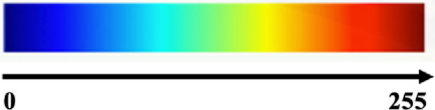
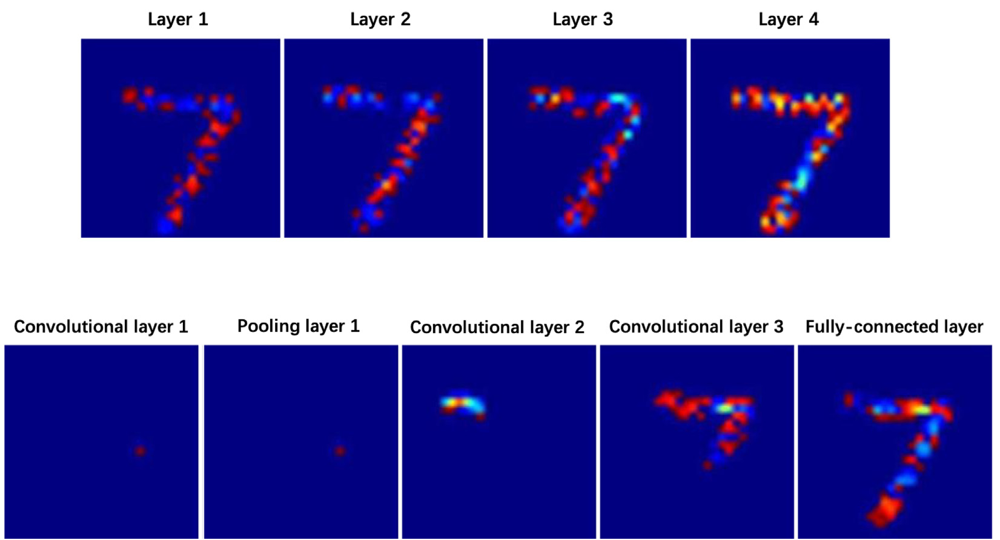
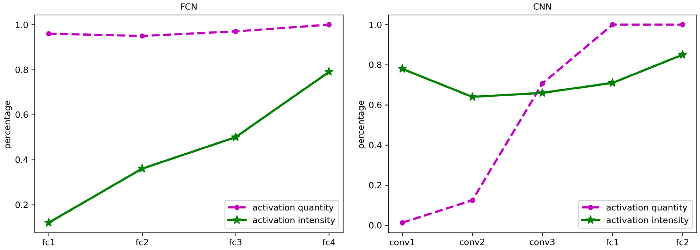
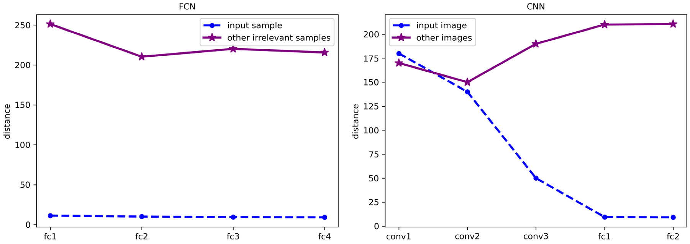
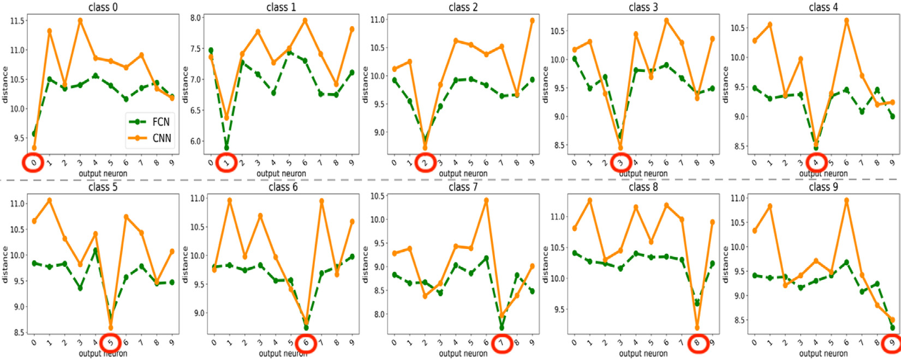
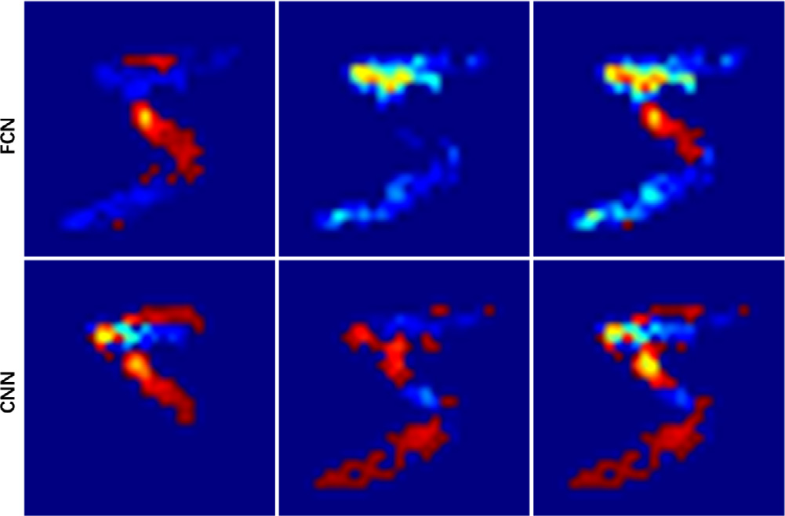
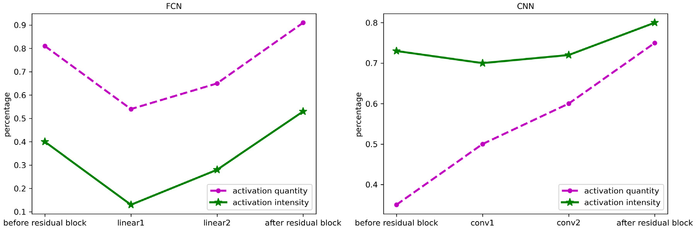
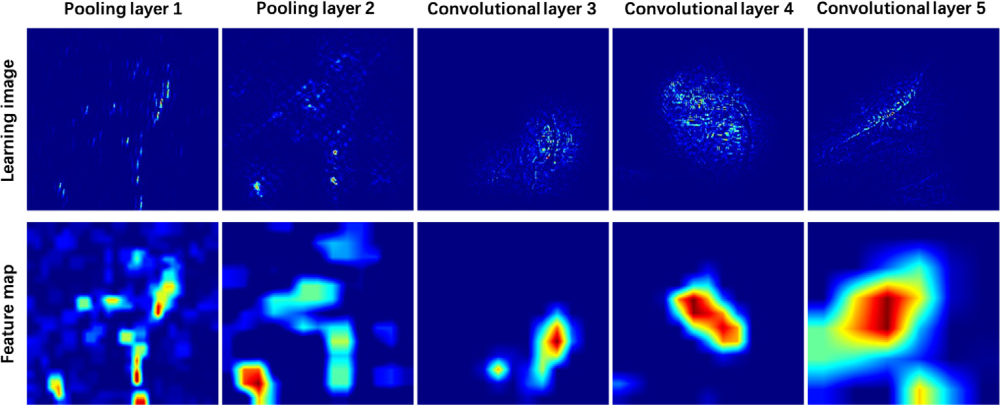
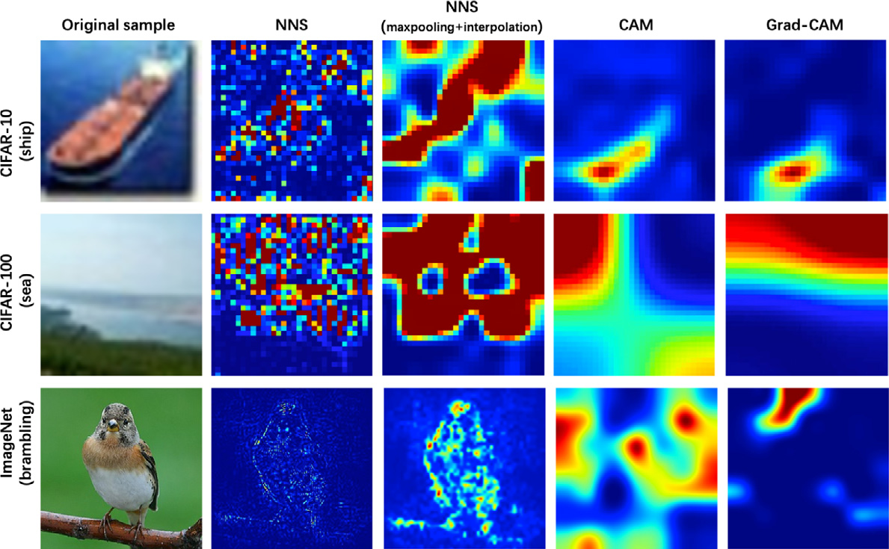

# 4. 实验

在 CNN 中，我们将特征图中的每个单元视为一个神经元。为了清晰地区分图像中不同的像素强度，我们采用热图形式来表示图像。热图使用不同颜色表示不同的像素强度，其颜色映射如图 6 所示。图像中的像素值越大，该像素的颜色就越接近“红色”；像素值越小，其颜色就越接近“蓝色”。为了证明本方法的适用性，我们将其应用于一组具有不同神经网络架构的模型。神经网络的详细说明见表 1。在第 4.1 节中，带有和不带跳跃连接的神经网络均在 MNIST 上训练；在第 4.2 节中，模型在 ImageNet、CIFAR-10 和 CIFAR-100 上训练。所有模型均采用反向传播（BP）学习算法进行训练。

*图 6. 热图的颜色映射。*

**表 1. 神经网络的详细说明。**

| 架构 | 数据集 | 学习算法 |
|---|---|---|
| FCN | MNIST | BP |
| CNN | MNIST | BP |
| 带跳跃连接的 FCN | MNIST | BP |
| ResNet10 | MNIST | BP |
| AlexNet | ImageNet | BP |
| VGGNet | CIFAR-10、CIFAR-100 | BP |

## 4.1. 扫描不同的神经网络架构

为了分析不同架构模型工作机制之间的差异，我们在一个 FCN 模型和一个简单 CNN 模型上进行实验。此处使用的 FCN 模型包含一个输入层（784 个神经元）、两个隐藏层（500 个神经元）和一个输出层（10 个神经元）。简单 CNN 包含三个卷积层（10 个滤波器）、两个池化层、一个展平层、一个全连接层（64 个神经元）和一个输出层（10 个神经元）。我们选择一个简单数据集，以确保不同模型均得到良好训练。两个模型都在 MNIST 手写数字训练集上进行训练。

在以下实验中，我们首先在不同神经网络上验证所提方法的有效性，并分析其工作机制。其次，阐明不同模型的神经元学习规律。随后，探究获胜神经元所学特征的本质。最后，比较具有跳跃连接的不同架构之间的学习过程。

### 4.1.1. 工作机制比较

本节比较不同模型的工作机制。可视化训练完成的神经网络中的所有神经元，有助于深入理解模型的运行过程。给定同一个输入样本，我们在每一层中选择一个被激活的神经元来展示其学习图像。各层的扫描结果体现了神经网络学习的分层特征。对于 FCN，从图 7(a) 可以观察到，网络在每一层始终学习全局特征。对于每个神经元，我们都能看到输入样本的边缘轮廓。在第 1 层中，FCN 学到的特征在学习图像中仅由两种颜色表示；在第 3 层中，所学特征由多种颜色表示。低层学习单调特征，学习图像中的颜色变化较小；高层学习丰富特征，学习图像中的颜色变化较大。对于 CNN，我们观察到网络在每一层都学习具有较大颜色变化的丰富特征。如图 7(b) 所示，在低层（第一个和第二个卷积层）中，只有少数神经元被激活。低层响应图像局部区域中的特征；卷积层 3 则学习更大区域中的特征。池化层中的神经元从前一卷积层的神经元中选出。被选中神经元的值不会改变，因此其学习图像保持不变。CNN 中的全连接层同样学习全局特征。

*图 7. 神经元学习过程的可视化。（a）FCN 的 NNS：神经网络在每一层始终学习全局特征。低层学习单调特征，学习图像中的颜色变化较小；高层学习丰富特征，学习图像中的颜色变化较大。（b）CNN 的 NNS：卷积层 1 和卷积层 2 响应角点、边缘交汇等简单特征；卷积层 3 学习更复杂的特征。由于池化层中的神经元从前一卷积层的神经元中选出，神经元的学习图像不会改变。*

我们通过测量各层神经元学到的知识量来分析学习图像。知识量从两个方面评估：激活量和激活强度。对于一幅学习图像，激活量是激活像素的数量，激活强度是像素强度之和。为了便于比较，将某一层的激活量定义为该层所有神经元的平均激活量相对于输入图像激活量的百分比。类似地，将某一层的激活强度定义为该层所有神经元的平均激活强度相对于输入图像激活强度的百分比。激活量和激活强度越大，神经网络从输入样本中学到的知识越多。

图 8 展示了 FCN 和 CNN 的知识量。如图 8(a) 所示，在 FCN 中，各层的激活量始终保持在很高的水平；激活强度则随着层数增加而显著增大。如图 8(b) 所示，卷积层的激活量随层数增加而增大。与其他卷积层的激活强度相比，第一个卷积层的激活强度最大，其他卷积层的激活强度变化不显著。在 CNN 中，全连接层知识量的变化趋势与 FCN 中全连接层的变化趋势相似。

*图 8. FCN 与 CNN 各层知识量的比较。在 FCN 中，知识量的变化主要通过激活强度的变化实现；在 CNN 中，知识量的变化主要通过激活量的变化实现。*

通过实验，我们分析了 FCN 和 CNN 的工作机制。在 FCN 中，知识量的变化主要通过激活强度的变化实现。尽管第一层已经学到了全局特征，但这些只是初步特征。随着层数增加，学习图像的激活强度增大，FCN 在图像相同位置所学特征的复杂度也随之提高。在 CNN 中，知识量的变化主要通过激活量的变化实现。低层神经元学习简单的局部特征，高层神经元学习复杂的全局特征。

### 4.1.2. 神经元学习规律

为了明确神经元所关注的特征，我们计算学习图像与数据集样本之间的相似度。我们将学习图像与相应输入样本之间的相似度，同该学习图像与其他无关样本之间的相似度进行比较。两个图像之间的相似度通过计算它们之间的距离来衡量。输入样本 $I$ 与神经元 $o$ 的学习图像 $I_o$ 之间的距离计算如下：

$$
dist_o^I=lVert I_o-I
Vert. 	ag{15}
$$

距离越大，图像之间的相似度越低，反之亦然。如图 9 所示，我们计算学习图像与其对应输入样本之间的距离。为了进行比较分析，还计算同一学习图像与其他无关样本之间的距离。

*图 9. 学习图像与数据集样本之间的相似度。我们将学习图像与对应输入样本之间的相似度，同该学习图像与其他无关样本之间的相似度进行比较。距离越大，图像之间的相似度越低，反之亦然。全连接层神经元所学特征在各层中始终与输入样本的特征保持较高相似度。卷积层中的神经元倾向于学习固定特征，但这一性质会随着层数增加而减弱。*

在 FCN 中，如图 9(a) 所示，无论在哪一层，学习图像与其他无关样本之间的距离，都远大于学习图像与其输入样本之间的距离。全连接层中的神经元没有固定的学习特征，神经元学到的特征始终与输入样本高度相关。

在 CNN 中，由于池化操作不会改变神经元的学习图像，我们只展示卷积层和全连接层中神经元的学习图像。如图 9(b) 所示，在卷积层 1 和卷积层 2 中，学习图像与其他无关样本之间的距离，同学习图像与输入图像之间的距离相近。低层卷积层中的神经元倾向于学习固定特征。在卷积层 3 中，学习图像与输入图像之间的距离小于学习图像与其他无关样本之间的距离。与低层卷积层的学习图像相比，高层卷积层的学习图像与输入图像更加相似。全连接层中神经元学习图像的变化趋势与 FCN 中全连接层的变化趋势相似。

通过实验，我们分析了不同神经网络架构的学习规律。全连接层神经元所学特征在各层中始终与输入样本中的特征保持较高相似度。全连接层神经元学到的特征并不固定，而是随输入样本变化。全连接层神经元学习全局特征，并获取全局轮廓信息；这种信息是指定输入样本与其他无关样本之间的明显区别。卷积层中的神经元倾向于学习固定特征，但这一性质随着层数增加而减弱。低层卷积层中的神经元关注图像局部小范围内的指定局部特征，这些特征与输入样本的全局轮廓关系很小。在高层卷积层中，神经元会在更大范围内学习更复杂的特征，所学特征与输入样本之间的相似度也随之提高。

### 4.1.3. 获胜神经元分析

在本实验中，我们探究神经网络输出层中的特征具有多强的判别能力。对于同一个输入样本，我们比较输出层中不同神经元恢复输入样本的能力。获胜神经元是与正确类别对应的输出神经元。输入样本 $I$ 与指定输出神经元 $o$ 的学习图像 $I^o$ 之间的距离按照式 (15) 计算。属于类别 $c$ 的所有输入样本记作 $I^c$。$I^c$ 与指定神经元 $o$ 之间的距离，表示为类别 $c$ 中每个样本与神经元 $o$ 之间距离的平均值：

$$
DIST_o^c=rac{sum_{Iin I^c}dist_o^I}{N}, 	ag{16}
$$

其中，$N$ 是类别 $c$ 的输入样本数。

输入样本与输出神经元学习图像之间的距离如图 10 所示。第 $c$ 个子图展示了属于类别 $c$ 的输入样本与不同输出神经元之间的距离。当 $o=c$ 时，距离最小。在每个子图中，无论对于 FCN 还是 CNN，与其他输出神经元的学习图像相比，获胜神经元的学习图像都更接近输入样本。获胜神经元所学特征与输入样本最为相似。换言之，与输出层中的其他神经元相比，获胜神经元能更好地恢复输入样本。

*图 10. 输入样本与输出神经元学习图像之间的距离。第 $c$ 个子图展示了属于类别 $c$ 的输入样本与不同输出神经元之间的距离。在每个子图中，无论对于 FCN 还是 CNN，与其他输出神经元的学习图像相比，获胜神经元的学习图像都更接近输入样本。获胜神经元所学特征与输入样本最为相似。换言之，与输出层中的其他神经元相比，获胜神经元能更好地恢复输入样本。*

为了分析获胜神经元的性质，我们针对 FCN 和 CNN，分别在三个准确率不同的神经网络上测量获胜神经元，结果见表 2。首先分析距离与准确率之间的关系。表中给出了获胜神经元学习图像与输入样本之间的距离。对于 FCN 和 CNN，模型准确率越高，距离越小。换言之，准确率较高的神经网络所学特征与输入样本更加相似。随后，我们测量获胜神经元学习图像的激活强度和激活量。如表 2 所示，无论对于 FCN 还是 CNN，获胜神经元的激活强度均随模型准确率提高而增大。对于 FCN，不同神经网络中的激活量始终为 1；对于 CNN，激活量随准确率提高而增大，并始终保持在较高水平。对于 FCN 和 CNN，准确率不同的神经网络中的获胜神经元都能获得全局特征信息。准确率更高的神经网络，其获胜神经元学到的特征具有更高的激活强度。

**表 2. 获胜神经元的结果。**

| 指标 | FCN 40 | FCN 70 | FCN 90 | CNN 40 | CNN 70 | CNN 90 |
|---|---:|---:|---:|---:|---:|---:|
| 准确率 | 40 | 70 | 90 | 40 | 70 | 90 |
| 距离 | 9.10 | 8.84 | 8.47 | 8.91 | 8.52 | 8.35 |
| 激活强度 | 0.589 | 0.648 | 0.665 | 0.427 | 0.453 | 0.678 |
| 激活量 | 1.0 | 1.0 | 1.0 | 0.995 | 0.996 | 0.998 |

### 4.1.4. 具有跳跃连接的架构

在本节中，我们比较具有跳跃连接的不同架构之间的学习过程。实验采用一个带有残差块的全连接架构和一个 ResNet10 模型。我们比较残差块之前、残差块内部以及残差块之后的神经元学习图像。同一位置神经元学习图像的变化如图 11 所示。残差块中的神经元所学特征与残差块之前的神经元所学特征不同。图 12 展示了带跳跃连接的不同架构的知识量。对于 FCN，残差块中神经元的激活量和激活强度均低于残差块之前的神经元；加入残差块之后，神经元的激活量和激活强度都显著提高。对于 CNN，激活量始终保持增长趋势；与残差块之前相比，残差块中的激活强度有所下降；加入残差块之后，激活量显著提高，激活强度则略有上升。对于 FCN 和 CNN，残差块都提高了神经网络的知识量。

*图 11. 具有跳跃连接的全连接架构（上）与具有跳跃连接的卷积架构（下）之间的比较。分别展示残差块之前（左）、残差块内部（中）和残差块之后（右）的神经元学习图像。*

*图 12. 具有跳跃连接的不同架构之间的知识量比较。对于 FCN，残差块中神经元的激活量和激活强度均低于残差块之前的神经元。加入残差块之后，神经元的激活量和激活强度都显著提高。对于 CNN，激活量始终保持增长趋势；与残差块之前相比，残差块中的激活强度有所下降；加入残差块之后，激活量显著提高，激活强度略有上升。*

## 4.2. 评估 CNN 的可解释性

在以下实验中，我们评估 CNN 的可解释性。我们以 AlexNet 和 VGGNet 为代表模型来分析 CNN。这些模型在 ImageNet 上训练。首先，通过评估模型中某一层的可解释性来验证 NNS 的有效性；随后分析同一层中高度激活神经元的学习能力；最后将 NNS 的可视化结果与现有方法进行比较。

### 4.2.1. 按层评估可解释性

我们开展实验，以分析为单个神经元生成学习图像是否具有意义。特征图具备物体定位能力，因此将特征图作为基线。通过测量 CNN 模型中单个层的学习图像与特征图之间的相关性来评估可解释性。某一层的学习图像，是该层所有神经元学习图像之和。我们发现，一层的学习图像与相应特征图高度相关。换言之，一层所学到的特征，是构成该层的所有神经元所学特征之和。

我们使用的模型是 AlexNet 和 VGGNet。对于输入图像，$F^{k,l}$ 是第 $l$ 层中滤波器 $k$ 的特征图。$f_{(x,y)}^{k,l}$ 表示 $F^{k,l}$ 在空间位置 $(x,y)$ 处的激活值。$I_{(x,y)}^{k,l}$ 是 $F^{k,l}$ 中位置 $(x,y)$ 处神经元的学习图像。使用 $I^{k,l}=sum_{x,y}I_{(x,y)}^{k,l}	imes f_{(x,y)}^{k,l}$ 表示第 $l$ 层中滤波器 $k$ 的学习图像。为了将低分辨率特征图与输入分辨率的学习图像进行比较，采用双线性插值将特征图 $F^{k,l}$ 放大到掩膜分辨率 $S^{k,l}$。特征图与学习图像之间的相关性表示为：

$$
C^{k,l}=rac{S^{k,l}cap I^{k,l}}{I^{k,l}}. 	ag{17}
$$

式 (17) 是交并比的一种变体。由于学习图像中的细节特征多于特征图，我们以 $I^{k,l}$ 取代 $S^{k,l}cup I^{k,l}$，使公式对变化更加敏感。一层中特征图与学习图像之间的相关性为：

$$
C^l=rac{sum_{kin K}C^{k,l}}{K}, 	ag{18}
$$

其中，$K$ 是该层的滤波器数量。在第 $l$ 层中，$C^l$ 越大，特征图与学习图像之间的相关性越高，反之亦然。

根据模型的不同，选择不同层来测量特征图与学习图像之间的相关性。对于 AlexNet，我们选择池化层 1、池化层 2、卷积层 3、卷积层 4 和卷积层 5；对于 VGGNet，我们选择池化层 1、池化层 2、池化层 3、池化层 4 和池化层 5。

相关性结果见表 3。为方便起见，以下将这些层分别称为第 1 层、第 2 层、第 3 层、第 4 层和第 5 层。对于 AlexNet 和 VGGNet，特征图与学习图像在不同层中始终保持较高程度的相关性，两个模型的表现相当。在低层（第 1 层和第 2 层）中，特征图与学习图像之间的一致性非常高。特征图通过双线性插值被放大到输入分辨率；与学习图像相比，特征图缺少细节。因此，在高层（第 3 层、第 4 层和第 5 层）中，一致性有所下降。

**表 3. 特征图与学习图像之间的相关性。**

| 模型 | 第 1 层 | 第 2 层 | 第 3 层 | 第 4 层 | 第 5 层 |
|---|---:|---:|---:|---:|---:|
| AlexNet | 0.998 | 0.872 | 0.641 | 0.634 | 0.623 |
| VGGNet | 0.952 | 0.923 | 0.688 | 0.620 | 0.538 |

图 13 展示了 AlexNet 各层中特征图与其相应学习图像的比较结果。学习图像与其相应特征图高度相关，且学习图像中的信息比相应特征图更加详细。由此可知，输入分辨率的学习图像能够展示模型学到的特征；一层所学到的特征，是构成该层的所有神经元所学特征之和。

*图 13. AlexNet 中的学习图像（上）及其对应的特征图（下）。每一层中的学习图像均与其对应特征图高度相关。学习图像所含信息比相应特征图更加详细。*

### 4.2.2. 按神经元评估可解释性

借助 NNS，我们分析并比较同一卷积层中各神经元的学习图像。对于输入图像，在每个卷积结果中选择激活值最高的两个神经元，展示它们的学习图像。这些神经元是一层中最具代表性的神经元。我们发现，两个代表性神经元的学习图像高度相似，而且这些神经元倾向于在图像中的相近位置学习特征。

第 $l$ 层中滤波器 $k$ 的两个最高激活值神经元的学习图像分别为 $I_1^{k,l}$ 和 $I_2^{k,l}$。使用交并比测量这两个神经元之间的相关性：

$$
IoU^{k,l}=rac{I_1^{k,l}cap I_2^{k,l}}{I_1^{k,l}cup I_2^{k,l}}. 	ag{19}
$$

这些神经元在一层中的相关性为：

$$
IoU^l=rac{sum_{kin K}IoU^{k,l}}{K}, 	ag{20}
$$

其中，$K$ 是该层的滤波器数量。

两个最高激活值神经元的相关性汇总于表 4。与前述实验相同，我们为不同模型选择不同层来测量相关性。在低层（第 1 层和第 2 层）中，相关性很高。高度激活的神经元倾向于在相近位置学习相同特征。尽管在高层（第 3 层、第 4 层和第 5 层）中相关性有所下降，高度激活神经元所学的特征仍具有一致性。VGGNet 中高度激活的神经元在不同层中始终保持较高相关性。VGGNet 中神经元的相关性强于 AlexNet。低层中高度激活的神经元倾向于学习相似特征，而高层神经元的学习能力在不同模型之间存在明显差异。

**表 4. 高度激活神经元的学习图像相关性。**

| 模型 | 第 1 层 | 第 2 层 | 第 3 层 | 第 4 层 | 第 5 层 |
|---|---:|---:|---:|---:|---:|
| AlexNet | 0.999 | 0.953 | 0.761 | 0.676 | 0.615 |
| VGGNet | 0.997 | 0.990 | 0.873 | 0.835 | 0.804 |

### 4.2.3. 评估可视化结果

本节将 NNS 与 CAM 和 Grad-CAM 进行比较。在 CIFAR-10、CIFAR-100 和 ImageNet 上的可视化比较结果如图 14 所示。对于 NNS，我们展示输出层中获胜神经元的学习图像。NNS 生成的热图与原始图像大小相同。CAM 和 Grad-CAM 先生成小尺寸热图，再通过插值将其放大到原始图像尺寸，因此它们的热图比 NNS 的热图更平滑。与大尺寸的 ImageNet 数据集相比，这一现象在小尺寸的 CIFAR-10 和 CIFAR-100 上更加显著。为了降低该现象对比较结果的影响，我们对 NNS 结果进行最大池化和插值。NNS 展示模型从输入样本中学到了什么，以及模型如何描述样本；其他算法则展示模型的关注区域。在 CIFAR-10 和 CIFAR-100 上，NNS 展示物体特征信息；在 ImageNet 上，可以看到 NNS 描述了输入样本的轮廓和重要细节。

*图 14. 不同方法的可视化结果比较。CAM 和 Grad-CAM 先生成小尺寸热图，再通过插值将其放大到原始图像尺寸，因此它们的热图比 NNS 的热图更平滑。为了降低这一现象对比较结果的影响，我们对 NNS 结果进行最大池化和插值。在 CIFAR-10 和 CIFAR-100 上，NNS 展示物体特征信息；在 ImageNet 上，NNS 描述输入样本的轮廓和重要细节。*
