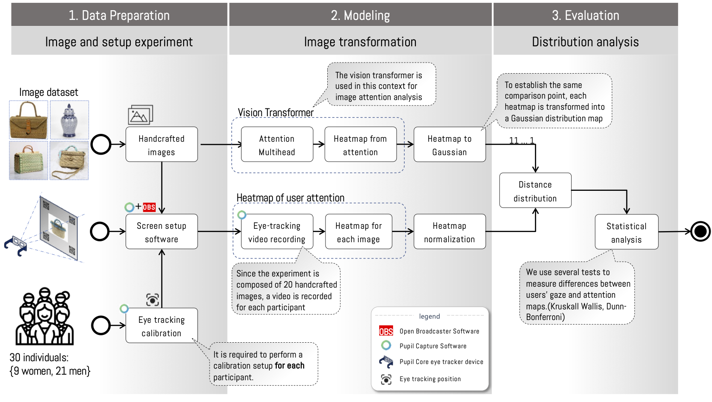
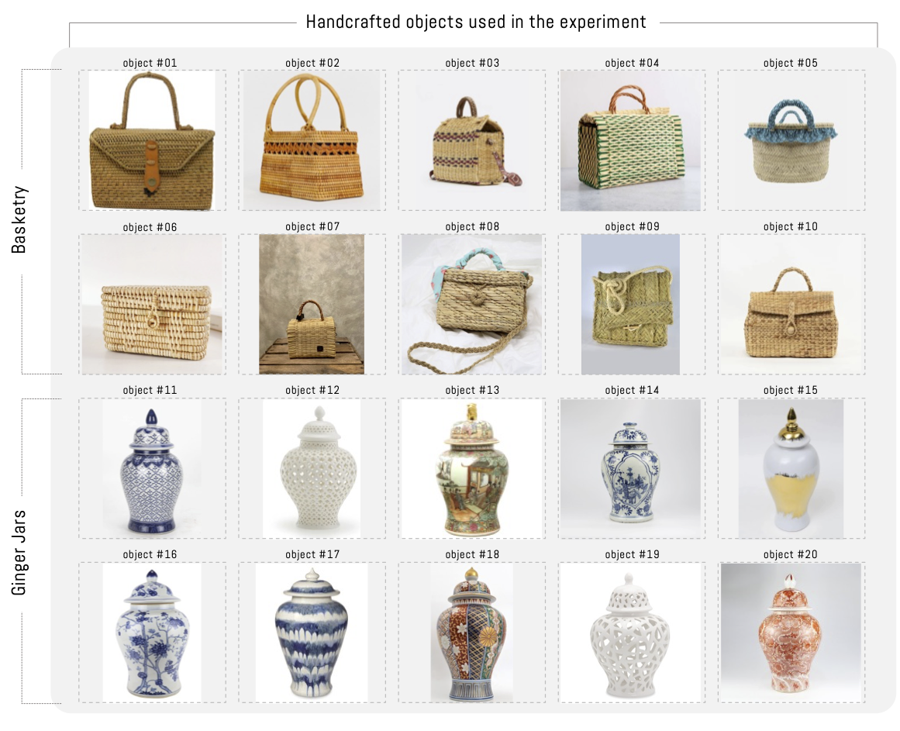
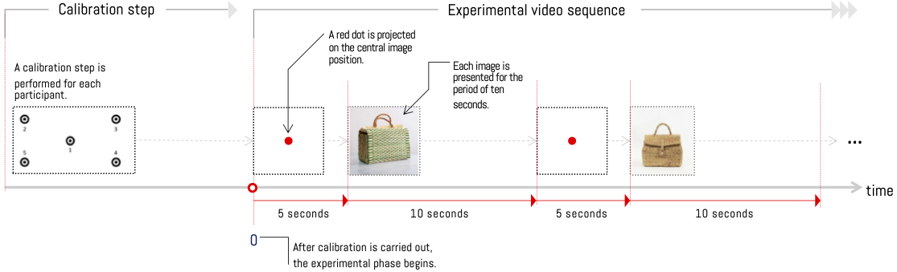
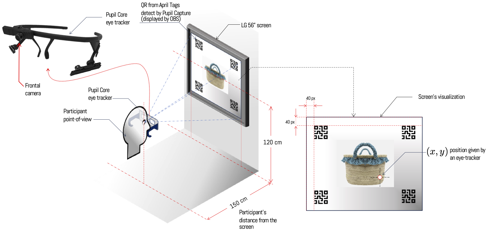
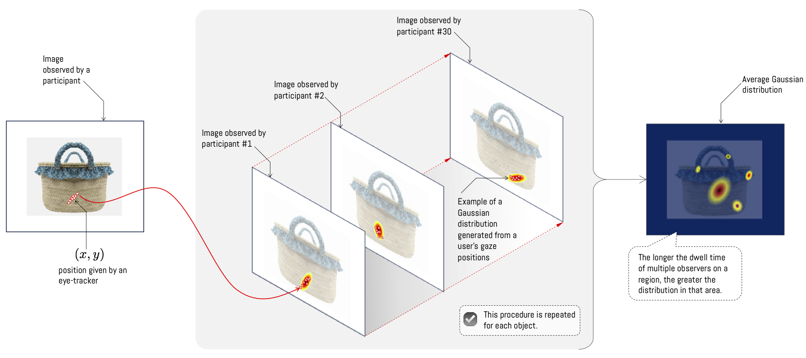

# 2. Materials and methods

The methodology is composed of three stages defined as data preparation, modeling, and evaluation. Each of them is composed of sub-components that allow the integration of the experiment through the flow of information between software and experimental components (see Fig. 1). Below we explain each of the stages in detail.

*Fig. 1. **General diagram of the experimental attention analysis process**. The process is composed of three stages: 1) data preparation and experimental setup, 2) image transformation, and 3) distribution analysis. Data preparation and setup consists of the image evaluation process by each experiment participant. This stage requires the use of an eye-tracker to determine the gaze position of experiment participants and define the experimental conditions. Image transformation consists of generating an attention map through the ViT attention module and experimentally by users on a set of objects. The last stage performs the comparison between both information sources and thus determines if there is any type of correlation*

## Data Preparation

The experiment consists of viewing a group of images by a set of people in a controlled environment through an eye-tracker. The analyzed objects correspond to craft pieces, specifically basketry and ginger jars which form part of the RRRemaker project[^1]. The selection was composed of ten basketry objects and ten jars, which can be seen clearly and without relevant external visual distractors (see Fig. 2). The selected objects vary slightly in sizes and decorations, maintaining unity in their materials, colors and shapes, to reduce distractions and force attention toward details. In the case of the jars, these have curvilinear forms and common structures, but with variations mainly highlighted in decorations (colors, figures and shapes). In both cases, scene distractors have been reduced and all are free of logos and text.

*Fig. 2. Objects used in the experiment composed of ten basketry objects and ten ginger jars. The objects were randomly selected taking into consideration that there should be the fewest possible objects in the background.*

To record the visual information from participants, we have used a Pupil Core model eye tracker from Pupil Labs manufacturer through the Pupil Capture software. This software allows recording from multiple device sensors, such as microphone, front camera, and pupil refraction cameras. Additionally, the software performs camera synchronization for eye tracking calculation through a calibration process (Fig. 3 calibration step). This process allows precise determination of the user’s gaze on the experiment screen. To do this, it relates the gaze position on the screen with the eye position relative to the eye-tracker’s internal camera.

*Fig. 3. **Experimental procedure for object visualization**. Before starting the experimental phase, a calibration procedure is performed with the recording of a sequence of five points on the screen. Once this process is completed, the experimental phase begins through the projection of an image with a white background and red dot which is displayed for 5 seconds. Then one of the 20 objects is displayed for 10 seconds. This procedure repeats until all objects have been displayed.*

The image sequences displayed have been carried out through the following procedure. First, a red dot is presented at the center of the screen for five seconds. Then each of the 20 objects is presented for ten seconds. Then it returns to the first step to transition object by object from the basketry set and then jars (Fig.  3). The objective of looking at a red dot during the transition between objects seeks to center the gaze in the same position at the beginning of displaying a new object. In this way, we reduce the error of gaze position by being situated in another position during the transition. On the other hand, displaying the image for 10 seconds was chosen as it is a time range that allows human attention to understand the most relevant information, decreases fixation generated by mental load, and provides a good amount of effective fixation samples(Locher et al. 2007).

The experiment uses a reference system that allows real-time location of gaze position on the screen. For this, it is necessary to employ four QR markers of the April Tags type which are recognized in real time by the Pupil Capture software and allow precise determination of gaze position on a reference system. This allows participants to make movements with their body and head with complete freedom, and the software to detect gaze position relative to the screen. This procedure has been carried out in combination with OBS (Open Broadcaster Software) which displays a QR code in each corner of the screen, along with object display through an application developed in Python. On the other hand, the distance between the screen and user has been maintained at 150 cm as it allows obtaining a large part of the participant’s visual field, minimizing visual fatigue (see setup in Fig. 4). This procedure has been implemented on an Asus TUF 15 computer with 16gb of RAM, Intel Core i5 CPU and an NVIDIA 1650 graphics card, and images have been projected on an LG screen with 56-inch resolution and 60 Hz refresh rate.

*Fig. 4. **Participant setup in front of the screen during the experimental phase**. All participants remain seated while the experiment is conducted. At the beginning of each experiment, a calibration process is performed with the eye-tracker, along with explaining the experiment to the participant. The chosen distance between the user and screen remains relatively fixed at 150 cm as it reduces visual fatigue.*

In order to obtain statistically valid results, the project has collected information from 30 participants, who voluntarily accepted the experiment and signed informed consent. The selected participants meet the following criteria: 1) being persons over eighteen years of age, 2) not reporting any pathology or ocular deficiency that would prevent them from viewing images at distances less than 150 cm away, and 3) not reporting any type of pupil refraction that would make it unfeasible to use an eye-tracker device with this type of technology. An exception was made if the condition can be corrected through contact lenses, as these do not alter the measurements of the eye tracker used. Additional details were recorded for all participants, such as age, gender, and area of knowledge or profession in order to analyze if there is any relationship between these factors and the visual attention of each examined individual.

## Modeling

"The data generated by the procedure described in Fig.  3 are processed using Pupil Player Software, allowing obtaining the gaze position of each participant; which are expressed as coordinates $(x,y)$ in relation to the viewing area (Fig. 5). Additionally, it is possible to obtain the timestamp, the corresponding frame of the recording, the pupil position coordinates, and the confidence level of the measurement. Thanks to the time and gaze position information, it is possible to estimate a Gaussian distribution over each coordinate taking into consideration the relative time of permanence at a determined location, which allows generating a heat map. The longer the gaze remains on a certain position in the image, the density in that region increases (see example in Fig.  5). This process is performed by each participant on the set of images, obtaining as a result a set of Gaussian distributions in each of the images; each distribution independent of the result of other observations. In this way, the distributions are considered independent, and it is possible to consider their average as the result of observation for each image (Fig.  5., Average Gaussian distribution example). Finally, in order to compare this result with the Vision Transformer attention module, the resulting distribution for each experiment image is normalized.

*Fig. 5. Heat map generation according to positions recorded by each observer. The heat map of each object is constructed as the average of individual visualizations transformed to a two-dimensional Gaussian distribution*

For Vision Transformer (ViT) training, the pre-training available in Facebook Research’s DINO (Self-DIstillation with NO Labels) repository has been used. This research uses a training scheme that consists of training a ViT using another in a teacher-student relationship. Specifically, a process known as self-distillation is applied in which two ViTs pre-trained with the same dataset without categories (ImageNet) but with different parameters are used. The same images are passed through each one with the difference that for the student they are segments of at most 50% of the image while the teacher has an equal or greater percentage. Then, the teacher ViT weights are updated using those of the student through the Exponential Moving Average (EMA) technique, and then centering is applied to the teacher with a mean over the batch to avoid dominance of any found feature. Finally, the softmax function is applied to calculate the cross-entropy between both networks so that both maintain the same distribution. This form of training achieves better performance and classification power than supervised training, in addition to superior segmentation of relevant zones which allows for clearer visual contrast with human attention (Caron et al. 2021b).

The architecture used generates as a result 12 independent distributions, each stored in one head of the attention module. In this way, it is possible to consider the average result of the 12 heads (similar to the analysis applied to participants), or consider each of the distributions as an independent result. To visualize the attentions generated by the ViT, specific functions were added that extract the weights obtained by each head of the attention module. In the same way as the attention transformation process was performed on participants, we have transformed each of the weights from the 12 heads to Gaussian distributions so that it is possible to analyze the differences between both.

## Evaluation

To analyze the differences between the heat maps generated by ViT attention and the average visualization of participants, we evaluate the distance between distributions. This comparison is performed through the Kullback-Leibler distance (Kullback 1997). The Kullback-Leibler distance, also called relative entropy, is a distance between distributions that is relative to one of them, in other words one is used as a reference point. A simple percentage difference calculation can tend to be more biased toward distributions with larger values and, therefore, Kullback-Leibler applies the logarithmic function to eliminate this bias. It is then multiplied by the distribution used as a reference point to apply the difference to each variable of the distribution.

$$
\begin{eqnarray}
\label{eq:KL}
    DKL(P(x)||Q(x)) = \sum_{x \in X} P(x) \log\left(\frac{P(x)}{Q(x)}\right)
\end{eqnarray}
$$

From Eq. ([eq:KL]) we determine the average distance of participants’ attention (see Fig.5: average Gaussian distribution) with each head of the attention module. The objective consists of determining if there is any head where the distance between the user’s gaze is similar to one of the heads of the attention module. For this, we use a statistical test that measures the difference between medians, which requires that the samples be independent, continuous, and of the same size. To determine which heads distribute differently, the Tukey Honestly Significant Difference (HSD) test was applied as a post-hoc test to each combination of possible head pairs with the same significance level.

To identify atypical heads, we have determined the p-values obtained to find the heads that achieved the lowest values in each combination and whether they did not exceed the null hypothesis through the HSD statistical test. In this way, it is possible to determine if the null hypothesis is refuted and, therefore, there is at least one different distribution.
