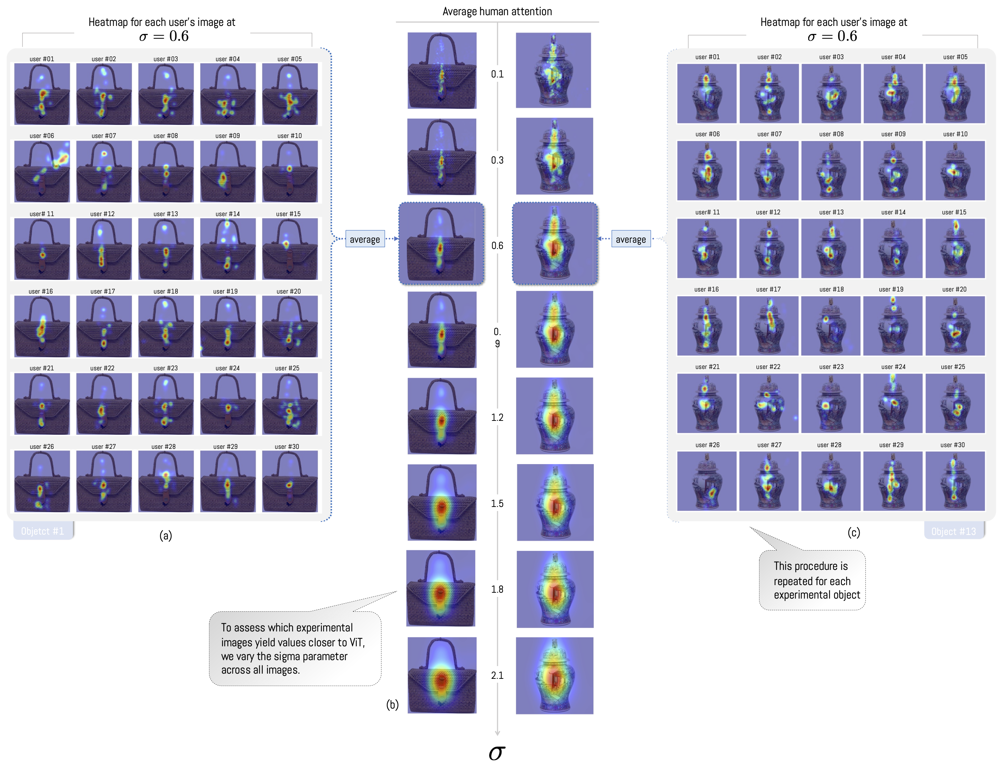
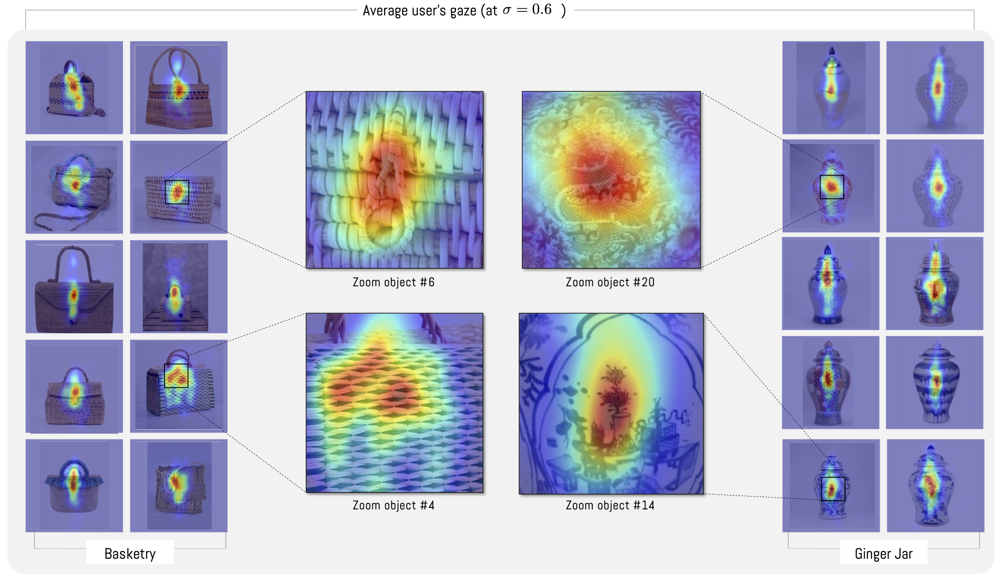
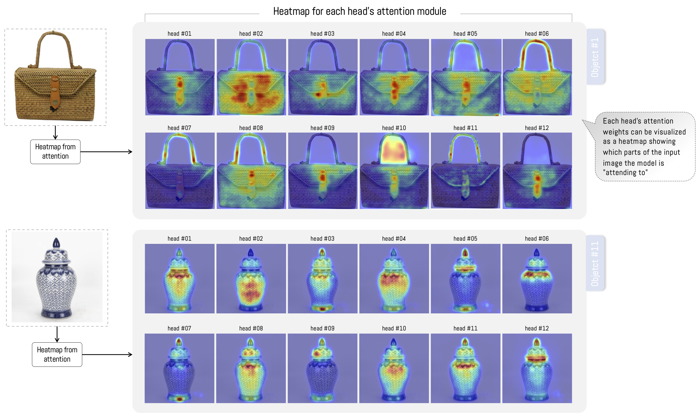
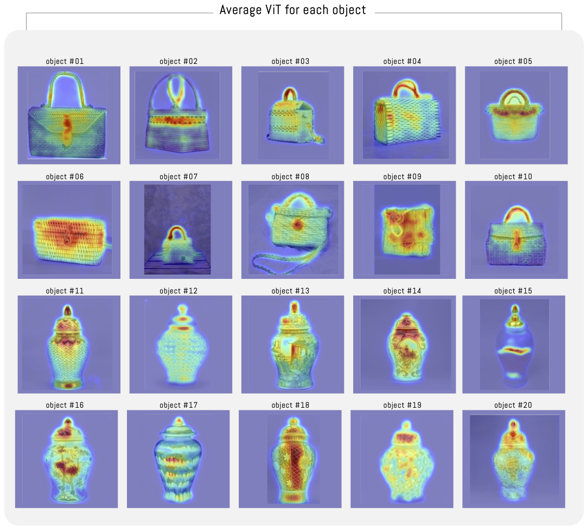
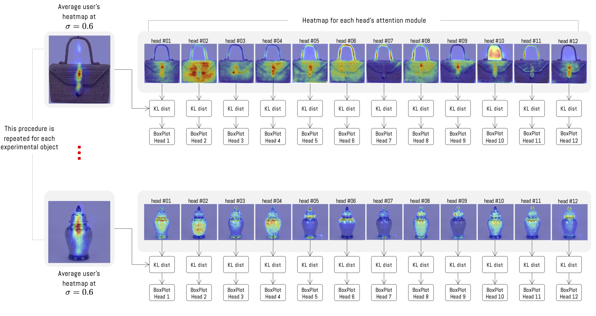
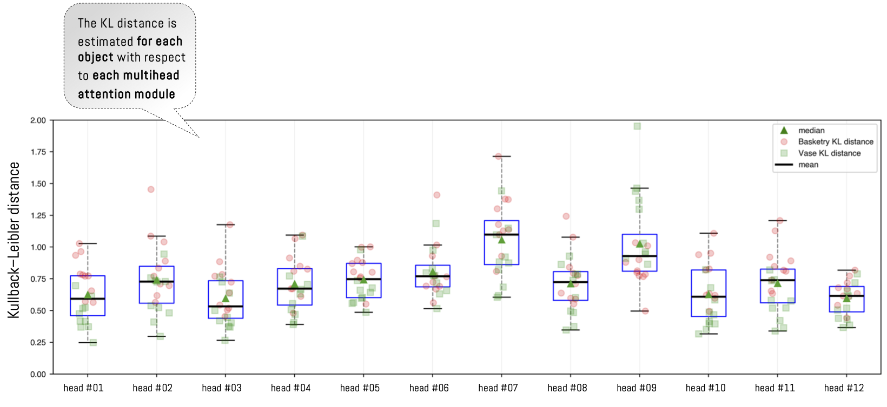
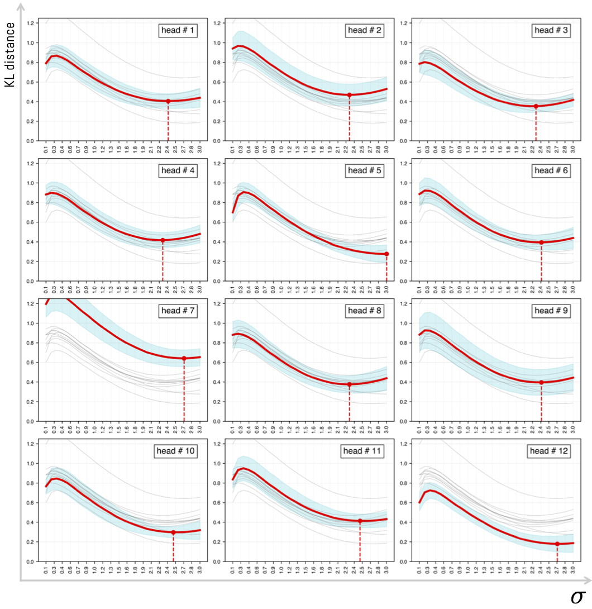
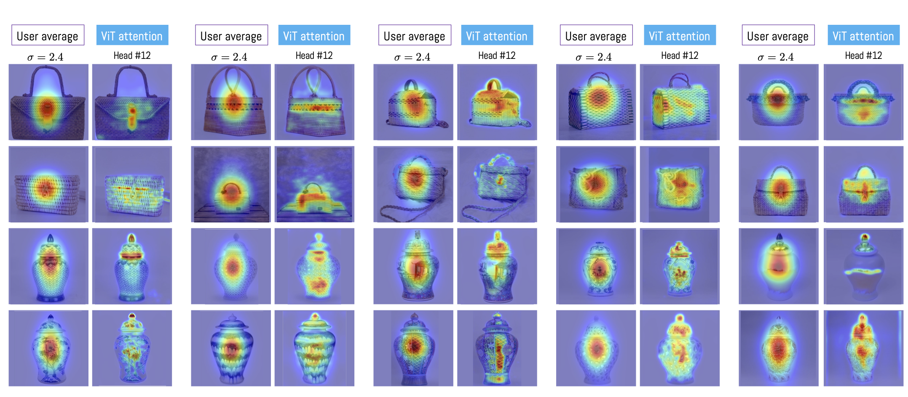
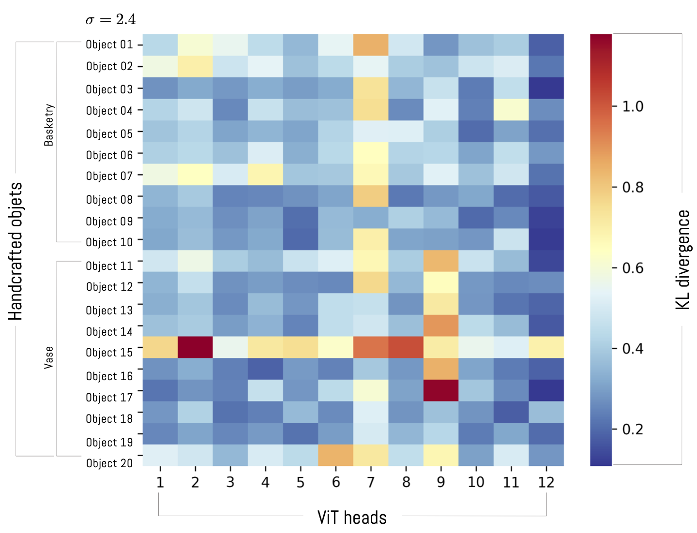
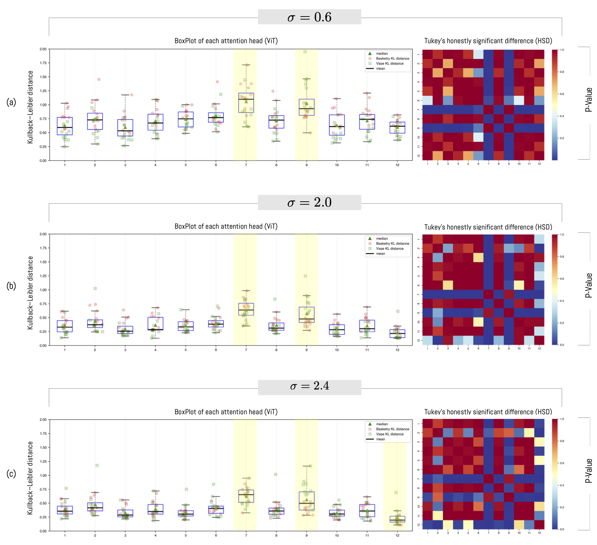

# 3. Results

This section presents the results obtained from the previously outlined methodology. We separate the analysis into participant visualization, ViT model results, and subsequently discuss the fundamental problem of this research, focused on the analysis of similarity and/or difference between ViTs and the average perception of participants.

## Sociodemographic information of participants

The experiment was conducted in the Neuroscience Laboratory of the School of Psychology at Universidad Adolfo Ibáñez (UAI) in Chile and has the approval of this institution’s ethics committee (certificate 57/2023). In total, 30 people participated who signed informed consent for conducting the experiment. Each of the participants agreed to provide sociodemographic information such as age, gender, and area of study knowledge (see Table 1). Of the total of 30 participants, 30% correspond to the female gender and 70% to the male gender, with an average age of 25.2 years $(SD=4.87)$ for the female gender and 24.3 years (SD=3.62) for the male gender, with a total average of 24.6 years $(SD=3.97)$. Regarding the area of knowledge they ascribe to, 53.3% is associated with the engineering and sciences area (mathematics, data science, computer science), 36.7% with social sciences and arts (law, humanities, arts), and 10% with the business area (marketing, business administration).

<table id="table1">
<caption>Sociodemographic information of participants</caption>
<thead>
<tr>
<th style="text-align: left;"></th>
<th colspan="4" style="text-align: center;"><strong>Count</strong></th>
<th colspan="4" style="text-align: center;"><strong>Mean (years)</strong></th>
<th colspan="3" style="text-align: center;"><strong><math display="inline" xmlns="http://www.w3.org/1998/Math/MathML"><semantics><mi>σ</mi><annotation encoding="application/x-tex">\sigma</annotation></semantics></math></strong></th>
<th style="text-align: right;"></th>
</tr>
</thead>
<tbody>
<tr>
<td style="text-align: left;"></td>
<td style="text-align: right;">BSN</td>
<td style="text-align: right;">SE</td>
<td style="text-align: right;">SSA</td>
<td style="text-align: right;"><math display="inline" xmlns="http://www.w3.org/1998/Math/MathML"><semantics><mi mathvariant="normal">Σ</mi><annotation encoding="application/x-tex">\Sigma</annotation></semantics></math></td>
<td style="text-align: right;">BSN</td>
<td style="text-align: right;">SE</td>
<td style="text-align: right;">SSA</td>
<td style="text-align: left;"><math display="inline" xmlns="http://www.w3.org/1998/Math/MathML"><semantics><mi>μ</mi><annotation encoding="application/x-tex">\mu</annotation></semantics></math></td>
<td style="text-align: right;">BSN</td>
<td style="text-align: right;">SE</td>
<td style="text-align: right;">SSA</td>
<td style="text-align: right;">All</td>
</tr>
<tr>
<td style="text-align: left;">Female</td>
<td style="text-align: right;">-</td>
<td style="text-align: right;">6</td>
<td style="text-align: right;">3</td>
<td style="text-align: right;">9</td>
<td style="text-align: right;">-</td>
<td style="text-align: right;">26,5</td>
<td style="text-align: right;">22,7</td>
<td style="text-align: left;">25,2</td>
<td style="text-align: right;">-</td>
<td style="text-align: right;">5,6</td>
<td style="text-align: right;">0,6</td>
<td style="text-align: right;">4,87</td>
</tr>
<tr>
<td style="text-align: left;">Male</td>
<td style="text-align: right;">3</td>
<td style="text-align: right;">10</td>
<td style="text-align: right;">8</td>
<td style="text-align: right;">21</td>
<td style="text-align: right;">27</td>
<td style="text-align: right;">24,4</td>
<td style="text-align: right;">23,1</td>
<td style="text-align: left;">24,3</td>
<td style="text-align: right;">7,8</td>
<td style="text-align: right;">1,1</td>
<td style="text-align: right;">3,7</td>
<td style="text-align: right;">3,62</td>
</tr>
<tr>
<td style="text-align: left;">Totals</td>
<td style="text-align: right;">3</td>
<td style="text-align: right;">16</td>
<td style="text-align: right;">11</td>
<td style="text-align: right;">30</td>
<td style="text-align: right;">27</td>
<td style="text-align: right;">25,2</td>
<td style="text-align: right;">23,0</td>
<td style="text-align: left;">24,6</td>
<td style="text-align: right;">7,8</td>
<td style="text-align: right;">3,5</td>
<td style="text-align: right;">3,1</td>
<td style="text-align: right;">3,97</td>
</tr>
</tbody>
</table>

Note: **BSN**: Business, **SE**: Sciences and Engineering, **SSA**: Social Sciences and Arts

## Participant visualization

The positions recorded by the eye-tracker allow constructing a heat map that identifies the regions where each user has maintained their gaze on the screen. Thus, 600 heatmaps were obtained (30 participants by 20 observed objects). Although Pupil Capture software generates as a result a position in terms of coordinates $(x,y)$, the density can be subsequently modified through the estimation of a two-dimensional Gaussian distribution as a function of the points visualized on the screen (see Fig.  5 and Fig.  6). This modification is performed by modifying the parameter $\sigma$, which defines the standard deviation of the Gaussian distribution (see change of $\sigma$ in Fig.  6b). In this way, as the parameter increases, so does the area and density of the zones where the average gaze of the study participants is centered. On the contrary, when $\sigma$ is low, we obtain isolated regions with low density (see example Fig.  6 when $\sigma=0.1$). To obtain the average heat map, it is necessary to sum the distributions generated by the 30 users (for the same object), and then normalize this result making the sum equal to 1.0. This process is repeated each time the parameter $\sigma$ varies, totaling 30 variants of $\sigma$for each object, where $\sigma\in\{0.1,0.2,0.3,...,3.0\} = \{0.1\times k | \space k \in \mathbb{N},\space 1\leq k \leq30\}$. This result is shown as a normalized average for each $\sigma$in Fig Fig. 6b. This process is performed to enable comparison of each average result with the results generated by the ViT attention module that will be analyzed subsequently

*Fig. 6. (a) heatmap of each user for object #1 (basketry), (b) average of participants’ gaze on an experiment image. As the parameter $\sigma$ increases, the greater the coverage area of the average vision. (c) heatmap of each user for object #13 (ginger jar).*

In general, it is observed that users focus their gaze at the center of objects (see Fig.  6 for object \#1). However, when performing this analysis for each object, large differences are observed between objects and their type. For example, in most basketry objects, users focus their gaze longer on the buckle, and do not pay attention to the object’s texture or its straps. In the case of jars, a displacement of gaze in a vertical direction is observed (Fig.  7). As in the previous case, the observed data show that there is observation of textures and limited observation of ginger jar objects. This is mainly because observation is related to the task. Since the experiment is free observation, there is no specific task that the user must execute when facing the observed objects. As a result of this process, we observe relevant differences between objects of the same category. For example, if we observe basketry objects \#4 and \#6, we notice that object \#4 does not possess a buckle like the rest of the category (Fig.  7, \#4). In this case, it is observed that the heat map generates a broader observation process since there is no zone or region that causes greater attention over other regions. On the other hand, if we observe the jars, we observe that the average gaze has vertical behavior, which in some cases concentrates on some areas of interest of the object when some emergent pattern exists (Fig.  7, \#14 and \#20).

*Fig. 7. Density of users’ average gaze for each object for $\sigma=0.6$. Basketry: Zoom object #4: Detail of region of an object without buckle. Zoom object #6: Detail of buckle with longer observation time by users. Ginger Jar: Zoom object #14 vase symbol with the highest amount of observation.*

## Images generated by the ViT attention module

Fig. 8 presents 12 heatmaps associated with the ViT attention module for objects \#1 and \#11. In the case of basketry-type objects, in some images the ViT attention focuses on texture or on other specific zones of the object such as the buckle or strap. Finally, in some cases a mixture of both is presented (texture and buckle or strap). In the case of ginger jars, each head focuses on a zone of the object, regularly coinciding in the central zone and in some cases on the jar lid. Fig. 9 presents the average of the 12 heatmaps for each object. The average shows how the attention module has more dispersed attention over the entire object. However, in the experiment images we notice relevant differences between the categories used. In this sense, in all basketry objects, the buckle is marked with greater density and then the strap over other zones. In the case of jars, the result is very variable, most of the time the ViT attention module focuses on the lid and in others on some zones with textures and drawings of the jar. In some extreme cases attention is concentrated on some characteristic of the object (see Fig. 9-object#15).

*Fig. 8. 12 heatmaps generated by the ViT attention module, both for a basketry-type object and for a jar. Each of the 12 heatmaps represents part of the attention visualization within the algorithm.*

*Fig. 9. Average heatmap of the 12 heads of the ViT attention module for each object in the experiment.*

## Differences between ViT and participant visualization

To measure the similarity or difference between the heat maps produced by ViT and human attention, we determine the distance using Kullback-Leibler (KL) divergence, which measures the statistical difference between two probability distributions on the same variable (Kullback 1997). To apply this distance, the images to be compared must be normalized (normMixMax \[0-1\]). This process is performed for each average image visualized by participants (Fig.  7) and each of the ViT heads (12 heatmaps per object) (see Fig.  10). It is important to indicate that we do not determine the distance with respect to the average ViT image shown in Fig. 9, since we seek to measure if there is any significant difference between any of the ViT heads with respect to the average visual attention of participants.

*Fig. 10. KL distance procedure between the 20 objects visualized by people versus each of the 12 heads of the ViT attention module. The figure illustrates the comparison case between object #4 and object #15 with respect to the 12 ViT heads.*

The comparison process is performed for each of the 20 objects visualized by participants (see average visualization in Fig.  7) against each of the 12 attention module heads independently (see example of the process in Fig.  10). In this way, we obtain 12 results for each of the objects (one per head). Since we have 20 objects in the experiment, we total 240 comparisons ($12 \times 20$) given a fixed $\sigma$. In order to visualize this distance for a given $\sigma$, the boxplot in Fig. 11 presents the distance between the average per object versus each head (given $\sigma=0.6$). In general, it is observed that the distances are similar between heads. However, heads \#7 and \#9 consistently have a greater distance than the rest of the heads. Since the experiment considers two categories of objects, it is possible to observe that there are differences from the same head for different categories. This means that heads can have a greater or lesser distance for some classes of objects than for others. For example, head \#1 consistently has a smaller distance for Jar-type objects than for Basketry-type objects. The opposite effect occurs in head \#9 where the head has better performance for basketry-type objects.

*Fig. 11. Each point in the BoxPlot represents the KL distance between one of the 20 objects and each of the attention heads. In this example, the parameter $\sigma$ is fixed at $0.6$.*

To analyze in detail the effect that variation of the parameter $\sigma$ has, we performed the same experiment varying the values of $\sigma$ between 0.1 and 3.0 with a step of 0.1. In this way, we analyze the average behavior of the KL distance as the parameter increases. Since for each value of $\sigma$, 240 comparisons are necessary, and added to the fact that we generate 30 incremental values of $\sigma$; in total we recorded 7200 combinations ($30\times 240$). The result of this comparison is presented in Fig. 12 separated by head. From the graph it can be seen that although each head may have a different result, in general it is observed that there exists an optimal value whose distance between the head and the average image of participants is minimal. The statistical results indicate that this value is found at $\sigma=2.4\pm 0.03$. In this sense, experimentally we observe that heads \#3, \#10 and \#12 are more similar to the average visualization of people and that, in addition, they possess the lowest variance among the different compared objects. As the parameter $\sigma$ begins to increase, the KL distance increases and at the same time the standard error of the sample (see blue background under each line). It is relevant to note that some of the heads do not have a result close to the average visualization of participants. This is the case of head \#7 and head \#9 where the dispersion is greater with respect to the other heads. This result had already been analyzed previously for the specific case of $\sigma=0.6$ (see Fig. 11). When analyzing the variation of $\sigma$ over a range of values, the same performance is observed consistently. This result is aligned with previous research where ViT heads do not necessarily fix attention to the same regions that an average human visualization would.

*Fig. 12. Variation of KL distance as the value of $\sigma$ increases for each of the heads. The KL distance has been calculated as the distance between the average visualization of all objects against each ViT head. The blue background corresponds to the sample confidence interval ($95\%$)*

Fig. 13 illustrates the difference between the average visualization of participants and head \#12 of the attention module for each of the 20 objects in the experiment. It is observed how the average visualization of participants tends toward the center of the image, in contrast, ViT head \#12 detects specific zones of the object, which in some cases coincides with the average visualization of participants. This example illustrates how one of the 12 heads tends to approximate the average visualization of experiment participants

*Fig. 13. Comparison between each average visualization with respect to head #12 of the ViT attention module. In the case of average visualization, a value of $\sigma=2.4$ has been considered.*

The KL distance with respect to each object and each attention module head are presented in Fig. 14. In this graph it is observed how head \#12 presents a difference from the other heads since it consistently has the lowest KL distance. However, it is interesting to note that the distance is lower for basketry objects versus ginger jars. On the contrary, heads \#7 and \#9 have the greatest distance with respect to the analyzed objects. In particular, head \#9 tends to have worse performance for jars than for basketry. This result highlights the difference and focus that the attention module possesses, and reveals that analyzing each head independently allows understanding the adjustment process of each head in relation to the average value of the ViT.

*Fig. 14. Heatmap with the KL distance between each object and each of the ViT attention module heads. This result has been calculated with $\sigma=2.4$*

To analyze the distance relationship between the different heads, we employed the Tukey Honestly Significant Difference (HSD) test after checking with an ANOVA test that there is significant difference between the means (see Fig.  15). For this we fixed the value of $\sigma=2.4$ and applied the test between all heads. The results indicate that heads \#7, \#9 and \#12 are statistically different from the rest of the heads, given that their p-values in most cases is less than 5%. These results, together with those presented in Fig. 14, allow us to affirm that heads \#7 and \#9 are those with the greatest distance to human visualization and head \#12 with the smallest distance.

*Fig. 15. Difference between Tukey Honestly Significant Difference (HSD) to measure the difference in means between attention module heads with three variants of $\sigma$.*
