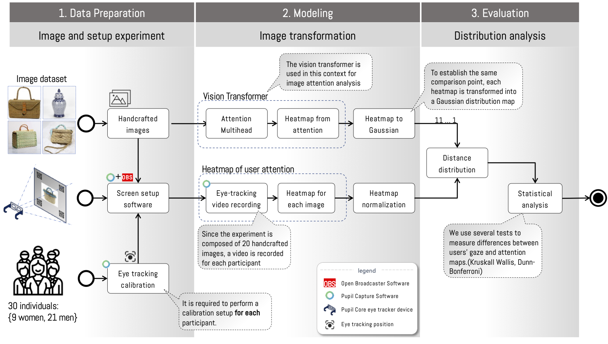
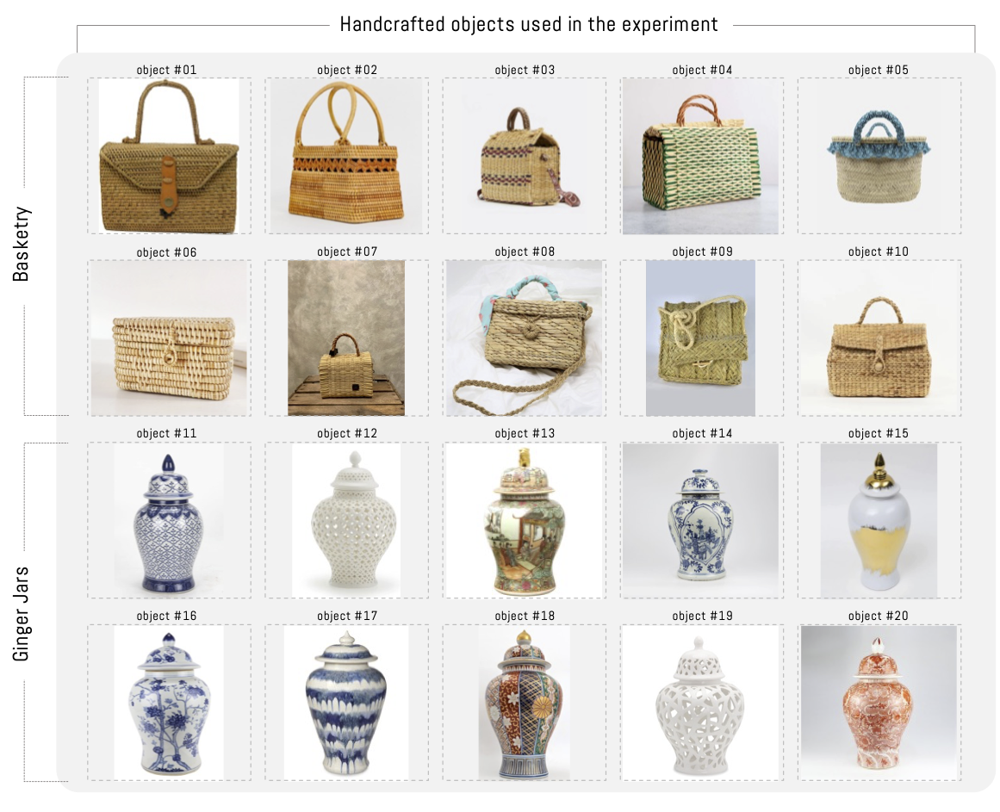
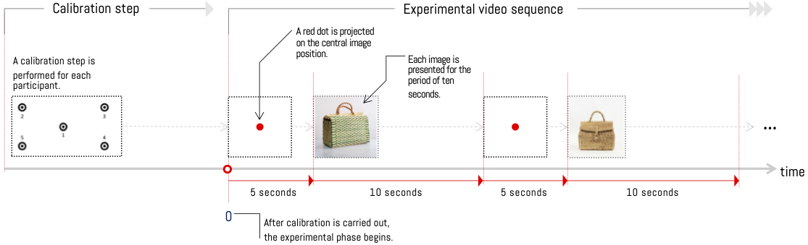
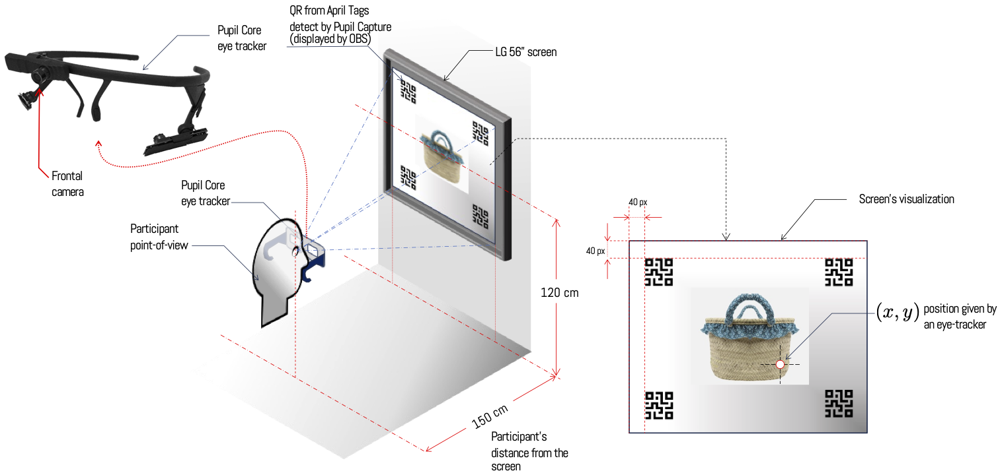
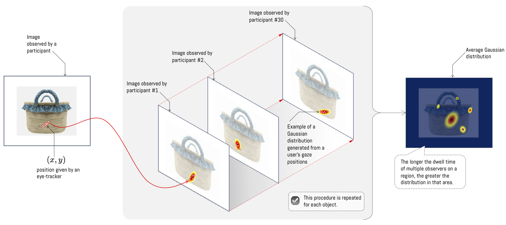

# 2. 材料与方法

该方法由三个阶段组成，分别定义为数据准备、建模和评估。每个阶段都包含子组件，这些子组件允许通过软件和实验组件之间的信息流来整合实验（见图1）。以下我们将详细解释每个阶段。

*图 1. **实验注意力分析过程的通用图示**。该过程由三个阶段组成：1）数据准备和实验设置，2）图像变换，3）分布分析。数据准备和设置包括每个实验参与者对图像的评估过程。这一阶段需要使用眼动追踪器来确定实验参与者的眼球注视位置，并定义实验条件。图像变换包括通过 ViT 自注意力模块生成注意力图，并由用户在一组对象上实验。最后阶段进行两种信息源之间的比较，从而确定是否存在某种类型的关联*

## 数据准备

实验包括一组图像在受控环境中通过眼动追踪设备由一组人观看。分析的对象是手工艺品，具体为篮子和姜瓶，属于RRRemaker项目[^1]。选择的物体包括十个篮子和十个姜瓶，这些物体清晰可见，且没有相关的外部视觉干扰（见图2）。所选物体在大小和装饰上略有不同，但材料、颜色和形状保持一致，以减少干扰并促使注意力集中于细节。对于姜瓶，它们具有曲线形和常见的结构，但主要在装饰（颜色、图案和形状）上有所不同。在所有情况下，场景干扰物已被减少，且所有物体均无品牌标识和文本。

*图 2 实验使用的对象包括十个篮子和十个姜罐。这些对象是随机选取的，考虑到背景中应尽可能少地包含这些对象。*

为了记录参与者从实验屏幕获取的视觉信息，我们使用了来自Pupil Labs制造商的Pupil Core模型眼动追踪器，通过Pupil Capture软件进行记录。该软件允许从多个设备传感器（如麦克风、前摄像头和眼动追踪器内部的瞳孔折射摄像头）中记录数据。此外，该软件通过校准过程进行摄像头同步，以进行眼动追踪计算（图3中的校准步骤）。该过程允许精确确定用户在实验屏幕上的注视位置。为此，它将屏幕上的注视位置与眼动追踪器内部摄像头相对于眼睛的位置相关联。

*图 3. **对象可视化实验流程**。在开始实验阶段之前，进行一个校准程序，记录屏幕上五点的序列。完成此过程后，通过投影带有白色背景和红色点的图像，该图像显示 5 秒，开始实验阶段。然后，将其中 20 个对象之一展示 10 秒。此程序重复直至所有对象均被展示。*

所展示的图像序列是通过以下程序进行的。首先，在屏幕上中心位置呈现一个红点，持续五秒钟。然后依次展示20个对象，每个对象展示十秒钟。然后返回第一步，依次过渡到篮子组和罐子（图3）。注视红点在对象过渡期间的目的是使注视位置在展示新对象时保持在相同的位置。这样，通过在过渡期间处于另一个位置，可以减少注视位置的误差。另一方面，选择展示图像十秒钟，因为这个时间范围允许人类注意力理解最相关的信息，减少由心理负荷产生的凝视，并提供足够的有效凝视样本（Locher et al. 2007）。

实验使用了一个允许在屏幕上实时定位注视位置的参考系统。为此，需要采用四块April Tags类型的QR标记，这些标记在Pupil Capture软件中实时识别，并允许在参考系统上精确确定注视位置。这使得参与者可以完全自由地进行身体和注意力头的移动，同时软件能够检测注视位置相对于屏幕的位置。这一过程与OBS（Open Broadcaster Software）结合使用，OBS在屏幕的每个角落显示一个QR码，并通过一个开发在Python的应用程序显示对象。另一方面，屏幕与用户之间的距离保持在150厘米，这使得能够获取参与者大部分视觉视野的一部分，从而减少视觉疲劳（参见图4的设置）。这一过程在一台配备16GB RAM、Intel Core i5 CPU和NVIDIA 1650图形卡的Asus TUF 15计算机上实现，并在56英寸分辨率和60赫兹刷新率的LG屏幕上投影图像。

*图 4. **实验阶段参与者面前的屏幕**。所有参与者在实验期间都保持坐姿。每次实验开始时，都会进行一次眼动追踪校准，并向参与者解释实验内容。用户与屏幕之间的选择距离保持在相对固定的 150 cm，以减少视觉疲劳。*

为了获得统计上有效的结果，该项目从30名自愿参与实验并签署知情同意书的参与者处收集了信息。所选参与者满足以下标准：1）年龄在18岁及以上，2）没有报告任何病理或眼部缺陷，这些缺陷会使其在距离小于150厘米处观看图像时无法视物，3）没有报告任何类型的瞳孔折射，这使得使用此类技术的眼 tracker 设备不可行。如果条件可以通过隐形眼镜矫正，则对此进行了例外处理，因为隐形眼镜不会改变眼 tracker 的测量结果。记录了所有参与者的额外详细信息，包括年龄、性别以及所涉及的知识领域或职业，以便分析这些因素与每位被检查个体的视觉注意力之间的关系。

## 建模

根据图 3 描述的程序生成的数据，使用 Pupil Player 软件进行处理，从而获取每位参与者的眼球注视位置；这些位置以相对于观看区域的坐标 $(x,y)$ 表达（见图 5）。此外，还可以获取时间戳、录制帧对应的帧、瞳孔位置坐标以及测量的置信水平。借助时间戳和注视位置信息，可以考虑相对时间在确定位置的停留时间，从而在每个坐标上生成一个高斯分布，这使得能够生成热力图。注视时间越长，该区域的密度越高（见图 5 示例）。通过这种方式，每个坐标上的分布被视为独立，可以考虑它们的平均值作为每个图像的观察结果（图 5，平均高斯分布示例）。最后，为了将结果与视觉 Transformer 注意模块进行比较，对每个实验图像的结果分布进行归一化。

*图 5. 根据每位观察者记录的位置生成热力图。每位对象的热力图是将其个体可视化转换为二维高斯分布后的平均值*

视觉 Transformer (ViT在预训练阶段，可供使用的预训练来自Facebook Research的DINO(无标签自我蒸馏) 项目已被使用。本研究采用了一种训练方案，该方案包括训练一个视觉 Transformer 模型。ViT使用另一种模型进行教师-学生关系。具体而言，应用了一种称为自蒸馏的过程，其中使用了两个视觉 Transformer（ViT）模型，这两个模型均使用了相同的未分类数据集（ImageNet）进行预训练，但参数不同。相同的图像被分别通过这两个模型，不同之处在于，对于学生模型，图像被分割为最多占图像50%的部分，而教师模型则保留了相同或更大的比例。然后，通过教师模型处理的图像片段被传递给学生模型。ViT通过使用学生模型的权重并通过指数加权平均（EMA）技术进行更新，然后对教师模型进行中心化处理，以平均值形式覆盖批次，以避免任何发现特征的主导地位。最后，通过计算两个网络之间的softmax函数来计算交叉熵，以使两者保持相同的分布。这种形式的训练比监督训练表现更好，分类能力更强，此外，它还能更清晰地分割相关区域，从而与人类注意力提供更明显的视觉对比（Caron et al. 2021b）。

使用的架构会产生12个独立分布，每个存储在注意力模块的一个注意力头中。这样，可以考虑12个注意力头的平均结果（类似于对参与者进行的分析），或者将每个分布视为一个独立的结果。为了可视化由ViT生成的注意力，添加了提取每个注意力模块注意力头权重的特定功能。就像对参与者进行了注意力变换一样，我们已经将12个注意力头中的每个权重转换为高斯分布，以便可以分析两者之间的差异。

## 评估

为了分析由 ViT 自注意力生成的热力图与参与者平均可视化之间的差异，我们通过评估分布之间的距离来进行比较。这一比较通过 Kullback-Leibler 距离（Kullback 1997）来进行。Kullback-Leibler 距离，也称为相对熵，是相对于其中一个分布的距离。换句话说，其中一个分布被用作参考点。简单的百分比差异计算可能会倾向于对具有较大值的分布产生更大的偏差，因此，Kullback-Leibler 使用对数函数来消除这种偏差。然后，它将乘以作为参考点的分布，以将差异应用于分布中的每个变量。

$$
\begin{eqnarray}
\label{eq:KL}
    DKL(P(x)||Q(x)) = \sum_{x \in X} P(x) \log\left(\frac{P(x)}{Q(x)}\right)
\end{eqnarray}
$$

从 式 ([eq:])KL我们确定了每个注意力模块注意力头之间用户注视点的平均距离（参见图5：平均高斯分布）。目标在于判断是否存在某个注意力头，其用户注视点与注意力模块中的某个头之间的距离相似。为此，我们使用了一种统计测试，该测试衡量的是中位数之间的差异，要求样本独立、连续且大小相同。为了确定哪些注意力头分布不同，我们使用Tukey Honestly Significant Difference（Tukey 意义上显著差异）检验。HSD测试结果被用作每一对可能注意力头组合的后验测试，具有相同的显著性水平。

为了识别异常头，我们已确定了在每种组合中找到的值最低的头所获得的p值，并检查它们是否未超过零假设。HSD统计检验。这样，就可以确定是否拒绝零假设，并因此至少存在一个不同的分布。
