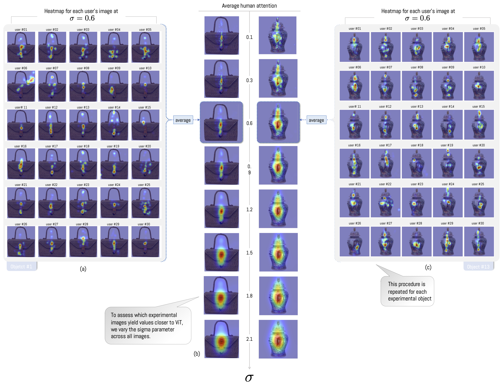
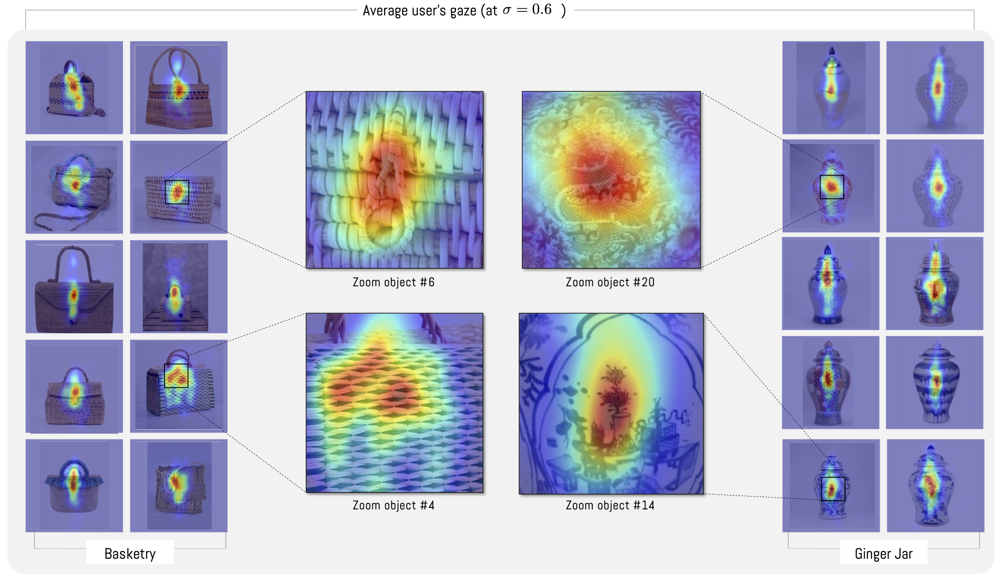
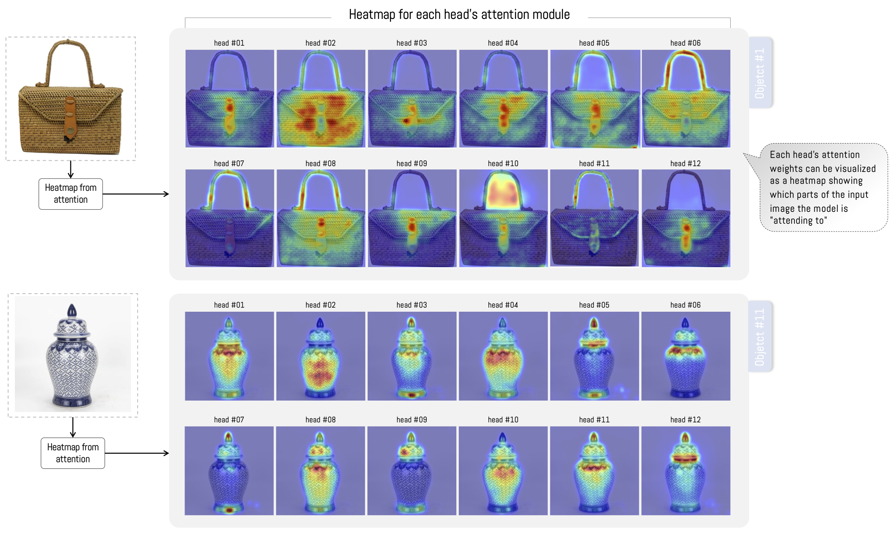
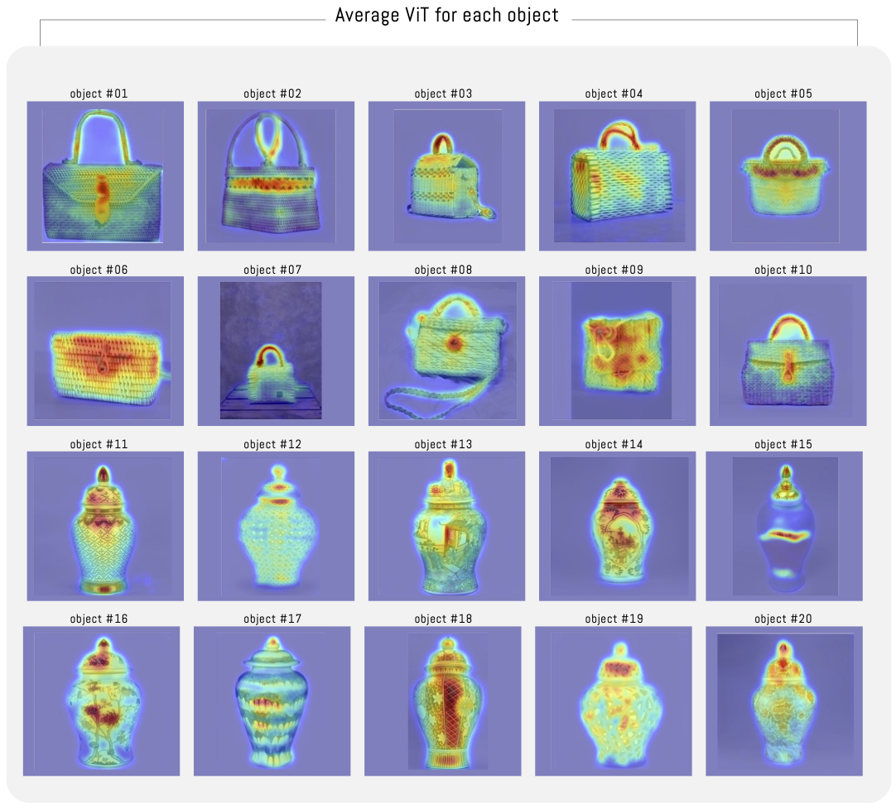
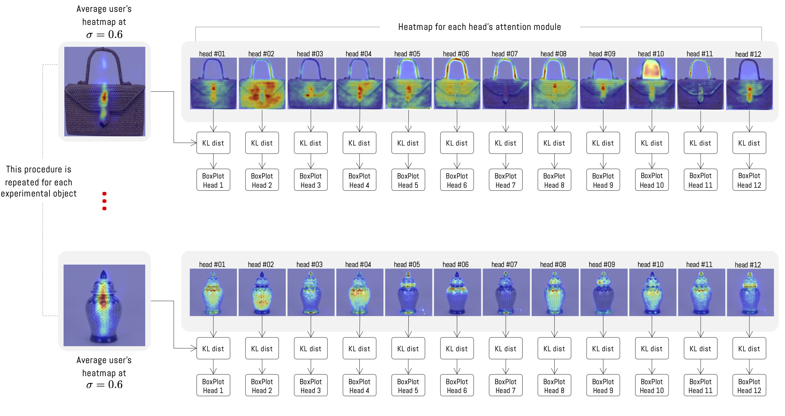
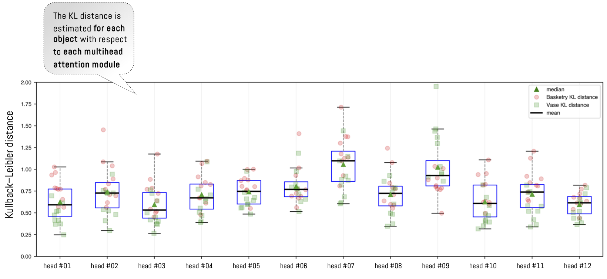
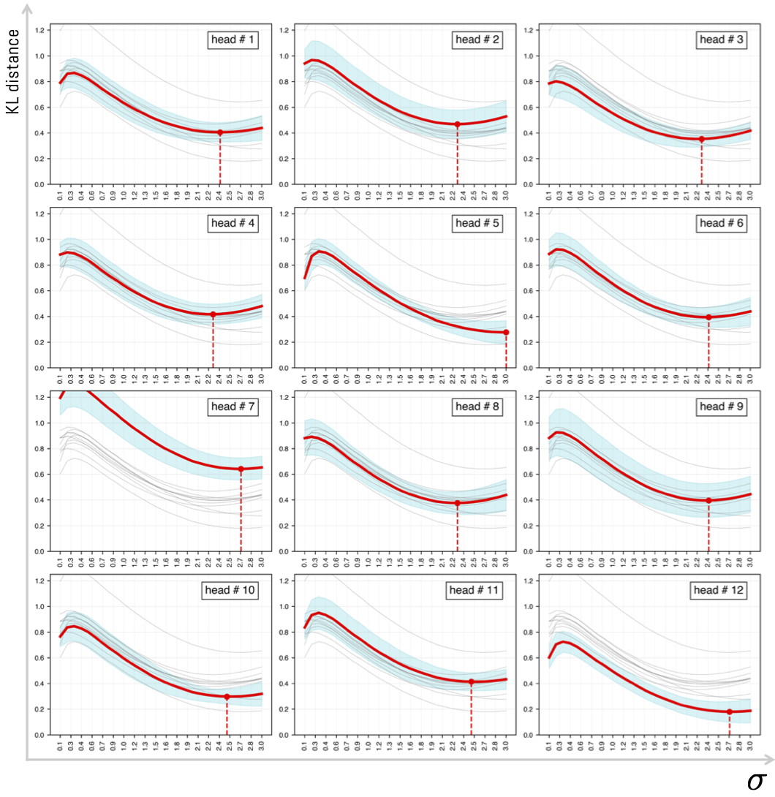
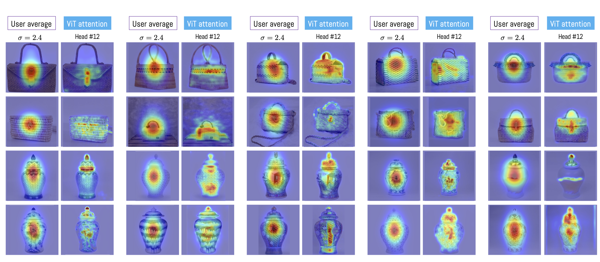
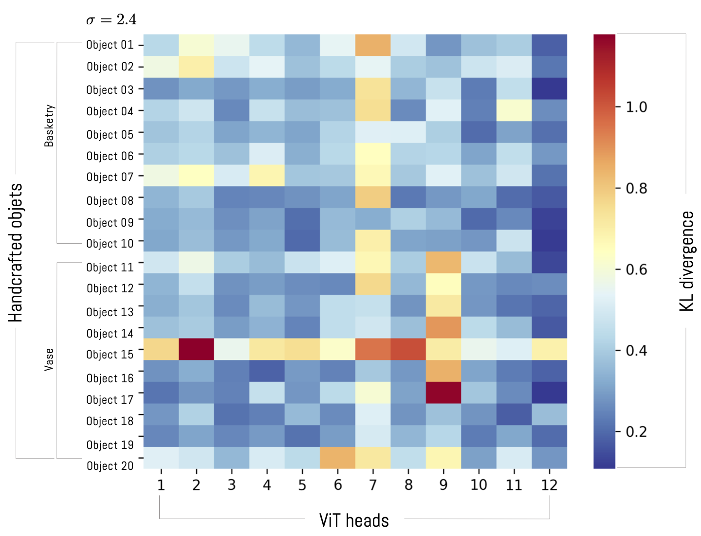
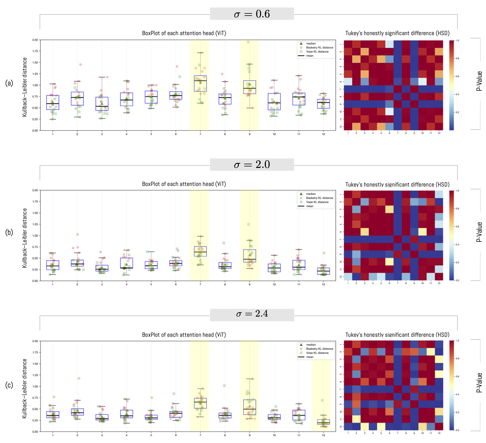

# 3. 结果

本节呈现了先前概述的 方法 所获得的结果。我们将分析分为参与者可视化、ViT 模型结果，并随后讨论本研究的基本问题，集中在对 ViT 与参与者平均感知之间的相似性或差异的分析上。

## 参与者社会人口学信息

实验在智利阿道夫·伊巴涅斯大学（UAI）心理学学院的神经科学实验室进行，并获得该机构伦理委员会的批准（证书号 57/2023）。总共 30 人参与，均签署了进行实验的知情同意书。每位参与者同意提供社会人口学信息，如年龄、性别和知识领域（见表 1）。在 30 名参与者中，女性占 30%，男性占 70%，平均年龄为 25.2 岁 $(SD=4.87)$（女性）和 24.3 岁（标准差=3.62）（男性），总平均年龄为 24.6 岁 $(SD=3.97)$。关于他们所属的知识领域，53.3% 与工程和科学领域（数学、数据科学、计算机科学）相关，36.7% 与社会科学和艺术领域（法律、人文、艺术）相关，10% 与商业领域（市场营销、商业管理）相关。

<table id="table1">
<caption>参与者的社会人口学信息</caption>
<thead>
<tr>
<th style="text-align: left;"> </th>
<th colspan="4" style="text-align: center;"><strong>计数</strong></th>
<th colspan="4" style="text-align: center;"><strong>平均 (年)</strong></th>
<th colspan="3" style="text-align: center;"><strong><math display="inline" xmlns="http://www.w3.org/1998/Math/MathML"><semantics><mi>σ</mi><annotation encoding="application/x-tex">\sigma</annotation></semantics></math></strong></th>
<th style="text-align: right;"> </th>
</tr>
</thead>
<tbody>
<tr>
<td style="text-align: left;"> </td>
<td style="text-align: right;">BSN</td>
<td style="text-align: right;">SE</td>
<td style="text-align: right;">SSA</td>
<td style="text-align: right;"><math display="inline" xmlns="http://www.w3.org/1998/Math/MathML"><semantics><mi mathvariant="normal">Σ</mi><annotation encoding="application/x-tex">\Sigma</annotation></semantics></math></td>
<td style="text-align: right;">BSN</td>
<td style="text-align: right;">SE</td>
<td style="text-align: right;">SSA</td>
<td style="text-align: left;"><math display="inline" xmlns="http://www.w3.org/1998/Math/MathML"><semantics><mi>μ</mi><annotation encoding="application/x-tex">\mu</annotation></semantics></math></td>
<td style="text-align: right;">BSN</td>
<td style="text-align: right;">SE</td>
<td style="text-align: right;">SSA</td>
<td style="text-align: right;">全部</td>
</tr>
<tr>
<td style="text-align: left;">女性</td>
<td style="text-align: right;">-</td>
<td style="text-align: right;">6</td>
<td style="text-align: right;">3</td>
<td style="text-align: right;">9</td>
<td style="text-align: right;">-</td>
<td style="text-align: right;">26,5</td>
<td style="text-align: right;">22,7</td>
<td style="text-align: left;">25,2</td>
<td style="text-align: right;">-</td>
<td style="text-align: right;">5,6</td>
<td style="text-align: right;">0,6</td>
<td style="text-align: right;">4,87</td>
</tr>
<tr>
<td style="text-align: left;">男性</td>
<td style="text-align: right;">3</td>
<td style="text-align: right;">10</td>
<td style="text-align: right;">8</td>
<td style="text-align: right;">21</td>
<td style="text-align: right;">27</td>
<td style="text-align: right;">24,4</td>
<td style="text-align: right;">23,1</td>
<td style="text-align: left;">24,3</td>
<td style="text-align: right;">7,8</td>
<td style="text-align: right;">1,1</td>
<td style="text-align: right;">3,7</td>
<td style="text-align: right;">3,62</td>
</tr>
<tr>
<td style="text-align: left;">总计</td>
<td style="text-align: right;">3</td>
<td style="text-align: right;">16</td>
<td style="text-align: right;">11</td>
<td style="text-align: right;">30</td>
<td style="text-align: right;">27</td>
<td style="text-align: right;">25,2</td>
<td style="text-align: right;">23,0</td>
<td style="text-align: left;">24,6</td>
<td style="text-align: right;">7,8</td>
<td style="text-align: right;">3,5</td>
<td style="text-align: right;">3,1</td>
<td style="text-align: right;">3,97</td>
</tr>
</tbody>
</table>

注意：**BSN**：商业，**SE**：科学与工程，**SSA**：社会科学与艺术

 

## 参与者视觉结果

眼动追踪记录的位置允许构建一个热力图，以识别每个用户在屏幕上注视的区域。因此，获得了600个热力图（30名参与者观察的20个观察对象）。尽管Pupil Capture软件的结果是以坐标形式生成的位置，$(x,y)$, 密度可以通过估计一个二维高斯分布来修改，该分布是基于屏幕上可视化点的函数（参见图5和图6）。此修改通过修改参数来实现$\sigma$，定义了高斯分布的标准差（参见变化）$\sigma$如图6b所示。因此，随着参数的增加，研究参与者注视平均中心的区域和密度也在增加。相反，当$\sigma$当该值较低时，我们得到密度较低的孤立区域（参见图6中的示例）。$\sigma=0.1$为了获得平均热力图，需要将30名用户的分布生成结果相加，然后对该结果进行归一化，使其总和等于1.0。每次调整参数时，都会重复这一过程。$\sigma$变化，总计30种变体。$\sigma$对于每个对象，其中$\sigma\in\{0.1,0.2,0.3,...,3.0\} = \{0.1\times k | \space k \in \mathbb{N},\space 1\leq k \leq30\}$. 这一结果以每个为标准化平均值的形式展示。$\sigma$如图6b所示。这一过程旨在使每个平均结果与由生成的结果进行比较。ViT随后将分析一种注意力模块。

*图 6. (a) 对象 #1（篮子）的每个用户热力图，(b) 实验图像上参与者平均注视的热力图。随着参数 $\sigma$ 增加，平均视野的覆盖面积越大。 (c) 对象 #13（姜罐）的每个用户热力图。*

总体而言，观察到用户倾向于注视物体的中心区域（参见图6中的对象#1）。然而，当对每个对象进行此类分析时，会发现对象之间存在显著差异。例如，在大多数篮子类对象中，用户更长时间地注视扣环，而忽略了对象的纹理或其带子。对于罐子，观察到视线在垂直方向上的偏移（参见图7）。正如在前一个案例中观察到的那样，观察数据表明存在纹理观察，并且对罐子对象的观察有限。这主要是因为观察与任务相关。由于实验是自由观察，用户在面对观察对象时没有特定的任务需要执行。因此，我们观察到同一类别中的对象之间存在相关差异。例如，如果观察篮子对象#4和#6，我们会注意到对象#4不像类别中的其他对象那样具有扣环（参见图7，#4）。在这种情况下，观察到热力图生成了更广泛的观察过程，因为没有区域或区域引起对其他区域的更大注意。另一方面，如果观察罐子，我们会观察到平均视线具有垂直行为，在某些情况下，当存在某些突发模式时，视线会集中在对象的某些感兴趣区域（参见图7，#14和#20）。

*图 7. 每个对象用户平均注视密度的密度图$\sigma=0.6$. 编织：放大对象 #4：无搭扣物体区域的细节。 放大对象 #6：用户观察时间更长的搭扣细节。 青花罐：放大对象 #14 有最高观察次数的花瓶符号。

## ViT 注意力模块生成的图像

图8展示了与之相关的12个热力图。ViT对于对象 #1 和 #11 的注意力模块。在篮子类型物体的情况下，有些图像中ViT注意力集中在物体的纹理上，或者集中在特定区域，如扣环或带子上。最后，在某些情况下，会同时呈现纹理和扣环或带子。对于姜黄色罐子，每个注意力头关注物体的某个区域，通常集中在中心区域，并且在某些情况下集中在罐盖上。图9展示了每个物体的12个热力图平均值。平均值显示了注意力模块在整个物体上的注意力更加分散。然而，在实验图像中，我们注意到类别之间存在显著差异。在这方面，在所有篮子类物体中，扣环的密度更高，然后是带子，而其他区域的密度较低。对于罐子，结果非常不一致，大多数情况下，注意力主要集中在罐盖上，而其他区域的注意力较少。ViT注意力模块关注的是罐盖，而在其他情况下则关注罐子上具有纹理和图画的一些区域（见图9-object#15）。在某些极端情况下，注意力集中于物体的某些特征（如图9-object#15所示）。

*图 8. 12 由视觉 Transformer 生成的 12 个热力图ViT注意力模块，既适用于篮子状物体，也适用于罐子。每个12个热力图均代表算法中注意力可视化的一部分。*

*图 9. 12 个注意力头的平均热力图ViT实验中每个对象的注意力模块。*

## ViT 与参与者视觉结果的差异

为了测量由视觉 Transformer 生成的热力图之间的相似度或差异性ViT为了确定距离，我们使用了Kullback-Leibler (KL) 概率 divergence。KL为了应用这种距离，需要将要比较的图像进行归一化（normMixMax \[0-1\]）。这一过程对于参与者可视化的所有平均图像（图7）中的每一个图像都进行了执行。ViT每个注意力头（12个对象每类）（参见图10）。重要的是要指出，我们并不根据平均值来确定距离。ViT如图9所示，由于我们旨在衡量任何一种方法是否在显著性上与其他方法存在差异，因此ViT注意力头相对于参与者平均视觉注意力。

*图 10.KL人可视化20个对象与12个视觉 Transformer头部之间的距离ViT注意模块。该图展示了对象 #4 和对象 #15 在 12 之间的比较情况。ViT注意力头.*

比较过程针对每个参与者可视化出的20个对象（参见图7中的平均可视化）分别与12个注意力模块头独立进行（参见图10中过程的一个示例），从而获得每个对象12个结果（一个头一个结果）。由于实验中有20个对象，因此总共进行了240个比较（$12 \times 20$给定固定$\sigma$. 为了可视化给定的距离，$\sigma$图11中的箱线图展示了每个头（在给定每个对象的情况下）的平均距离。$\sigma=0.6$总体而言，观察到不同头部之间的距离相似。然而，头部7和头部9始终比其他注意力头的距离更大。由于实验考虑了两类物体，因此可以观察到不同类别之间同一头部存在差异。这意味着某些注意力头对于某些物体类别的距离可能更大，而对于其他类别可能更小。例如，头部1始终对罐类物体的距离较小，而对篮子类物体的距离较大。相反，头部9对篮子类物体的距离较小，而对罐类物体的距离较好。

*图11. BoxPlot中的每个点代表一个样本的性能指标。KL一个对象与注意力头之间的距离。在这个例子中，参数 20$\sigma$设置为固定值。$0.6$.*

为了详细分析参数 $\sigma$ 变化的影响，我们进行了同样的实验，将 $\sigma$ 的值从 0.1 变化到 3.0，步长为 0.1。这样我们分析了随着参数增加，KL 距离的平均行为。由于对于每个 $\sigma$ 的值，需要进行 240 次比较，再加上我们生成了 30 个 $\sigma$ 的增量值；因此，总共记录了 7200 组合 ($30\times 240$。)。这些比较的结果如图 12 所示，按注意力头分隔。从图中可以看出，尽管每个注意力头可能有不同的结果，但一般观察到存在一个最优值，该值与参与者平均图像之间的距离最小。统计结果表明，该值位于 $\sigma=2.4\pm 0.03$。从实验的角度来看，注意力头 #3、#10 和 #12 更接近人们的平均可视化，而且与其他比较对象相比，它们具有最低的方差。当参数 $\sigma$ 开始增加时，KL 距离增加，同时样本的标准误差（见每条线下的蓝色背景）也增加。值得注意的是，有些注意力头的结果并不接近参与者的平均可视化。这是注意力头 #7 和 #9 的情况，其分散性比其他注意力头更大。这一结果已在特定情况下 $\sigma=0.6$ 的研究中被分析过（见图 11）。当分析 $\sigma$ 的变化范围时，观察到同样的性能。这一结果与先前的研究一致，即 ViT 的注意力头不一定固定在与平均人类可视化相同的位置。

*图 12. 视觉 Transformer 结构中参数量的变化KL值为距离$\sigma$多个注意力头中每个头的值都会增加。KL距离已经计算为所有对象的平均可视化与每个对象之间的距离。ViT注意力头。蓝色背景对应样本置信区间。$95\%$)*

图13展示了实验中20个对象中每个对象的参与者平均可视化与注意力模块第12个注意力头的平均可视化之间的差异。观察到的是，参与者平均可视化倾向于图像中心，而与之相反的是，ViT注意力头#12能够检测到对象的特定区域，在某些情况下，这些区域与实验参与者平均视觉的可视化相吻合。这一实例展示了注意力头之一倾向于逼近实验参与者平均视觉的特性。

*图 13. 每个平均可视化与视觉 Transformer 中第 12 个注意力头的比较ViT注意模块。对于平均可视化的情况，取值为$\sigma=2.4$已经被考虑过。*

The Vision TransformerKL图14展示了每个对象和每个注意力模块头之间的距离。在这张图中，可以观察到第12个注意力头模块与其他注意力头模块相比存在差异，因为第12个注意力头模块通常具有最低的距离。KL距离。然而，值得注意的是，对于篮筐类物品与姜瓶而言，距离较低。相反，第7号和第9号头与分析对象之间的距离最大。特别是，第9号头在瓶类物品上的表现不如在篮筐类物品上。这一结果突显了注意力模块的不同和重点，揭示了独立分析每个头能够理解每个头如何调整以适应整体值的调整过程。ViT.

*图 14. 热力图，包含注意力权重的可视化KL每个对象与每个对象之间的距离ViT注意力模块的注意力注意力注意力注意力注意力头数量量量量。这一结果是通过计算得出的。$\sigma=2.4$*

为了分析不同注意力头之间的距离关系，我们在使用 ANOVA 测试确认各组均值之间存在显著差异后，采用了 Tukey Honestly Significant Difference (HSD ) 测试（见图 15）。为此，我们固定了 $\sigma=2.4$ 的值，并对所有注意力头之间进行了测试。结果表明，注意力头 #7、#9 和 #12 在大多数情况下其 p 值小于 5%，因此与其他注意力头相比，它们是统计上不同的。这些结果，以及图 14 中呈现的结果，使我们能够确认注意力头 #7 和 #9 与人类视觉之间的距离最大，而注意力头 #12 则与人类视觉之间的距离最小。

*图 15. Tukey Honestly Significant Difference (HSD) 用于测量三种不同 $\sigma$ 的注意力模块头之间均值的差异。*
